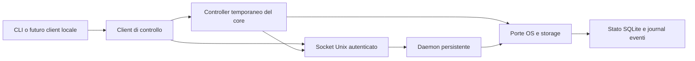

# Implementation Plan: Core Foundation & Background Daemon

**Branch**: `001-core-background-daemon` | **Date**: 2026-11-08 | **Spec**: [spec.md](spec.md)
**Input**: `/Users/fabioaltea/Repository/maestro/specs/001-core-background-daemon/spec.md`
**Stato**: piano tecnico per review; codice e benchmark non eseguiti.

## Summary

Realizzare un core headless locale con daemon indipendente dalla CLI, stato durevole,
operazioni idempotenti e recovery conservativo. Un controller transitorio del core completa
start/stop/restart anche dopo la disconnessione del client; il daemon è l'unico processo
persistente a riposo. macOS è la prima piattaforma, isolata dietro porte dedicate.

La ricerca è in [research.md](research.md); modello, contratti e verifiche sono in
[data-model.md](data-model.md), [contracts/](contracts/) e [quickstart.md](quickstart.md).
La verifica delle lacune e la copertura completa dei requisiti sono in
[plan-review.md](plan-review.md).
Eventi persistenti, streaming, replay e backpressure vengono introdotti in incrementi separati.
Provider, Agent Runtime, Git/worktree, pnpm ed Electron restano esclusi.

## Technical Context

**Language/Version**: TypeScript 6.0.3 strict, Node.js 26.13.0 LTS, ESM/NodeNext
**Primary Dependencies**: better-sqlite3 13.0.3; node:net, node:child_process, node:worker_threads, node:util; nessun framework server
**Storage**: SQLite locale (WAL, synchronous FULL), lease SQLite separati, journal eventi a segmenti con outbox limitata
**Testing**: node:test, node:assert, clock e porte sostituibili; integrazione macOS con processi reali
**Target Platform**: macOS 26.3 arm64, APFS locale; riferimento workspace 26.3.1; altri OS non supportati nella prima milestone
**Project Type**: singolo package core/daemon/CLI, senza UI
**Performance Goals**: target invariati SC-001–SC-010; avvio p95 5 s, stop p95 10 s, restart p95 15 s, stato p95 500 ms, recovery entro 30 s, eventi p95 1 s
**Constraints**: stato entro 2 s o errore; attese di controllo massimo 30 s; idle 150 MiB e CPU media 1% di un core; diagnostica 50 MiB più 5 MiB temporanei; 1 MiB per osservatore
**Scale/Scope**: 10 client, 1.000 operazioni, fino a 10 ausiliari di prova in recovery; carico eventi 100/s per 60 s

Le versioni sono baseline documentate in R1, da fissare nel futuro lockfile. Il package usa
npm soltanto per il proprio sviluppo: non gestisce dipendenze di repository utente.
Nessuna soglia sopra è un risultato misurato. La matrice di quickstart conserva tutti i
campioni, carichi e criteri della specifica.

## Constitution Check

Gate iniziale eseguito prima di consolidare la ricerca; gate finale riesaminato sul design.
PASS significa conformità progettuale, non test di implementazione già superati.

| Principio | Prima della ricerca | Dopo il design ed evidenza |
|-----------|---------------------|----------------------------|
| I. Local-first | PASS: tutto locale | PASS: archivio APFS, socket Unix, test senza rete; R2/R6/R8 |
| II. Core headless | PASS: daemon autonomo | PASS: controller e daemon detached nel core; CLI senza scritture SQL; contratti lifecycle/IPC |
| III. Provider agnostic | PASS: nessun provider nel dominio | PASS: operazioni e risorse generiche; adapter AI e checkpoint non applicabili a questa feature |
| IV. Git safety | N/A: nessuna operazione Git di prodotto | N/A confermato; bootstrap preserva modifiche esistenti, nessuna pulizia automatica |
| V. Recovery | PASS: stato e riconciliazione richiesti | PASS: intento/esito, requestId, lease, prova di cessazione, outbox; data-model e lifecycle |
| VI. Approvazioni | PASS: controllo esplicito | PASS: capability locale verificata nel core; solo azione richiesta; niente force/reset/pubblicazione |
| VII. Testabilità | PASS: confini sostituibili | PASS: porte OS, worker storage, clock; contratti e fault injection locale |
| VIII. Osservabilità | PASS: stato ed eventi previsti | PASS: seq persistente, journal limitato, replay/gap, redazione e budget; contratto eventi |

Nessuna violazione o deroga. Nessun obbligo di compatibilità con il vecchio Maestro.

## Project Structure

### Documentation (this feature)

Base assoluta: `/Users/fabioaltea/Repository/maestro/specs/001-core-background-daemon/`.

```text
spec.md
plan.md
research.md
data-model.md
quickstart.md
plan-review.md
contracts/
  cli.md
  local-protocol.md
  lifecycle.md
  platform-ports.md
checklists/
  requirements.md
```

`tasks.md` è riservato a una successiva invocazione di speckit-tasks, non creato qui.

### Source Code (repository root)

Struttura proposta per la futura implementazione, non creata da questo comando.
Root assoluta: `/Users/fabioaltea/Repository/maestro/`.

```text
package.json
package-lock.json
tsconfig.json
src/
  cli/main.ts
  client/local-client.ts
  core/
    control-main.ts
    daemon-main.ts
    inspect-main.ts
    lifecycle.ts
    operations.ts
    recovery.ts
    foundation-auxiliary-policy.ts
  domain/
    states.ts
    errors.ts
    identifiers.ts
  ports/
    platform.ts
    storage.ts
    clock.ts
  platform/macos/
    launcher.ts
    lease.ts
    process-identity.ts
    transport.ts
    paths.ts
  storage/
    worker.ts
    sqlite-store.ts
    schema.ts
    event-journal.ts
  protocol/
    messages.ts
    validation.ts
    event-pump.ts
tests/
  unit/
  contract/
  integration/
  fixtures/
  acceptance/
```

**Structure Decision**: un solo package evita workspace e servizi aggiuntivi.
Dominio → porte; core → dominio/porte; adapter → porte; composition root → implementazioni.
Nessun import di `platform/macos`, `better-sqlite3` o primitive di processo dal dominio.
I controlli di architettura verificano questi divieti. Il client non importa storage/core policy.

## Architecture and ownership



Il controller è autorizzato dal comando esplicito e non appartiene agli ausiliari del daemon.
Contiene le regole di controllo del core, non è logica nella CLI. La coppia control lease /
daemon lease separa serializzazione delle richieste e proprietà dell'istanza. Ogni processo
core che scrive usa uno storage worker; i lease restano nel thread principale. Un worker
guasto porta il proprietario a BLOCKED, mantenendo il lease finché il processo è vivo.

- Stato autorevole e transizioni: SQLite, gestito solo dal core.
- Stato vivo e sottoscrizioni: daemon; osservazioni dichiarate non persistite in caso di errore disco.
- Start/stop/restart e loro finalizzazione: controller detached, poi terminazione.
- Diagnostica a daemon assente: esecutore core read-only, nessun bootstrap implicito.
- Specificità OS: cinque adapter descritti in platform-ports.md.
- Recovery figli: sola policy Foundation; nessun automatismo imposto all'Agent Runtime.

Il client non può concludere «arrestato» da ECONNREFUSED o da un heartbeat scaduto.
Controller e daemon verificano proprietà, identità e stato corrente secondo lifecycle.md.

## Delivery increments

Ogni incremento ha dipendenze, rischio principale e verifica; sono unità di piano, non una
lista di task esecutivi. Sicurezza, limiti e test pertinenti accompagnano la prima esposizione
della capacità. L'intera feature è conclusa solo con SC-001–SC-010 e AR-001–AR-003 soddisfatti.

| Incremento | Dipendenze | Risultato e moduli | Verifica di uscita | Rischio |
|------------|------------|-------------------|-------------------|---------|
| F0 — Bootstrap | Nessuna | Inventario dei file da preservare, package greenfield, TS, runner e porte; nessuna cancellazione implicita | Build/typecheck e test architetturali; driver caricato sulla piattaforma iniziale | Dipendenza nativa, modifiche preesistenti |
| F1 — Prima slice headless | F0 | CLI start/status/stop, controller detached, daemon, lease, stato minimo, token e diagnostica di base | Terminale/CLI chiusi, stessa istanza; doppio avvio escluso; stop verificato, nessun accesso altro UID | Lifecycle reale e bootstrap concorrente |
| F2 — Restart e recovery | F1 | Intenti/esiti, retry, riconciliazione, risorse Foundation, gestione persistenza guasta | Crash in ogni finestra, stop bloccato, PID riutilizzato, no duplicazioni; US2/US3 | Esito perso e arresto incompleto |
| E1 — Eventi persistenti e consultazione | F2 | Outbox, journal, retention, lettura paginata, redazione | Commit/crash/append/ack e saturazione disco; eventi consultabili senza streaming | Atomicità fra stato e journal |
| E2 — Streaming limitato | E1 | Event pump live, byte accounting, disconnessione client lento già a 1 MiB | Due client, uno fermo; controllo reattivo, memoria limitata | Buffer impliciti e contesa |
| E3 — Replay e lacune | E2 | Cursore stabile, handoff replay/live, gap di retention, riconnessione | Nessuna omissione silenziosa; identità duplicate riconoscibili; stato riallineabile | Race fra replay, append e rotazione |
| V1 — Accettazione completa | E3 | Harness scenari e report prestazioni | Tutta la matrice di quickstart; target confrontati a misure reali | Assumere performance senza misurarle |

F1 è il primo incremento dimostrabile: nessun provider, nessuna esecuzione arbitraria.
F1/F2 persistono già lifecycle ed esiti necessari al recovery; E1 aggiunge la storia eventi
generale, non rinvia la sicurezza della persistenza. Un incremento parziale non viene
pubblicizzato come intera feature completa.

## Validation strategy

- Unitari: transizioni lecite, ambito autorizzazioni, decisioni di recovery e retry,
  clock monotono distinto dall'orologio civile.
- Contratti: versioni, frame, limiti, errori, idempotency key, capability, porte OS,
  output umano/JSON e codici di uscita.
- Integrazione: processi e filesystem reali su macOS, archivi temporanei, chiusura terminale,
  dieci avvii simultanei, fault injection controllata, ausiliari cooperativi/non cooperativi.
- Eventi: append parziale, crash dopo sync prima di ack, retention/replay, dieci osservatori,
  byte accounting e segreti sentinella.
- Benchmark: processi compilati senza inspector/watch; report con versione, ambiente,
  workload, campioni, target, misure e pass/fail. Nessuna misura è stata prodotta ora.

I punti di fault injection esistono solo nell'harness di test, non nei comandi pubblici.
I test non devono arrestare processi esterni al loro sandbox temporaneo.

## Risks and mitigations

| Rischio | Decisione e verifica |
|---------|---------------------|
| PID riutilizzato, processo irraggiungibile | Challenge per identità; nessun kill da PID salvato. Incertezza ⇒ BLOCKED anche a costo di intervento manuale |
| Crash del controller durante restart | RequestId e fase durevoli; prossimo comando esplicito riconcilia prima di avviare altre mutazioni |
| Candidato daemon avviato in ritardo | LaunchTicket con claim atomico e generation; ticket annullati o già consumati non autorizzano avvio |
| Connessione lease chiusa accidentalmente | Connection ownership unica nel main, nessun riuso inode; prove di contesa e morte del processo |
| Quota fisica diagnostica | Budget misurato comprensivo di overhead e WAL, batch limitati, pause di scrittura se checkpoint impossibile |
| Sincronizzazione file lenta | Worker separato, letture vive non bloccate; deadline esplicite e stato non verificato, mai falso successo |
| Artefatto locale estraneo o archivio corrotto | Fail closed, preservazione, diagnostica read-only; nessun reset automatico |
| Versioni/binari nativi | Pin nel bootstrap e test di caricamento; build locale documentata se manca prebuild |
| Overhead rispetto a 150 MiB/1% | Un daemon a riposo, controller transitorio; misurare RSS dell'intero processo inclusi worker, nessun allentamento automatico dei target |

## Complexity Tracking

Nessuna violazione costituzionale. Complessità intenzionali:

| Scelta | Perché necessaria | Alternativa più semplice insufficiente |
|--------|-------------------|----------------------------------------|
| Controller transitorio | Finalizzare stop dopo morte del daemon e completare restart senza CLI | La CLI non può detenere policy o garantire continuità |
| Due lease separati | Esclusione del controllo e della vita del daemon con durate diverse | Un solo lock bloccherebbe stop/restart o permetterebbe sovrapposizione |
| Outbox e journal limitato | Atomicità degli eventi con stato e limite fisico verificabile | Solo cancellare righe SQL non limita disco/WAL |
| Worker storage | Evitare che operazioni sincrone del driver blocchino IPC e deadline | I/O sincrono nel loop dei client rende più fragile SC-002 |

## Completion of this planning command

Ricerca e design completati; nessun chiarimento progettuale lasciato irrisolto.
Verifica di conformità finale positiva ai confini definiti sopra. AGENTS.md viene generato
dal comando Spec Kit e allineato ai soli comandi/tecnologie pianificati.
Specifica e Constitution restano invariate; nessuna implementazione, tasks.md o pulizia
della vecchia codebase. Hook di commit pre/post disponibili tramite `/speckit.git.commit`,
facoltativi e non eseguiti. La verifica dei punti mancanti è tracciata in plan-review.md;
le prove runtime e i benchmark rimangono gate della futura implementazione.
