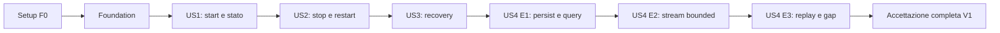

# Tasks: Core Foundation & Background Daemon

**Feature**: `001-core-background-daemon`
**Created**: 2026-11-08
**Input**: `/Users/fabioaltea/Repository/maestro/specs/001-core-background-daemon/`
**Prerequisites**: [spec.md](spec.md), [plan.md](plan.md), [research.md](research.md),
[data-model.md](data-model.md), [contracts/](contracts/), [quickstart.md](quickstart.md)
e [plan-review.md](plan-review.md).
**Status**: implementazione autorizzata dall’utente e in corso, con un commit per task.
T001–T045 completati; controllo US2 al checkpoint di review F2. T046–T087 ancora da eseguire. Nessuna pubblicazione autorizzata.

## Format: `[ID] [P?] [Story] Description`

- Checkbox [X] solo per task completati e committati; ID univoci e sequenziali.
- `[P]` indica task eseguibili insieme nella wave esplicita sotto, dopo le dipendenze.
  Non autorizza a ignorare dipendenze o assegnare contemporaneamente uno stesso file.
- `[US1]`–`[US4]` compaiono soltanto nelle fasi delle user story.
- Ogni task indica file esatti e dipendenze dirette. Una dipendenza di fase include
  tutti i task della fase precedente; i gate non sono facoltativi.
- I test sono richiesti esplicitamente dalla specifica: scriverli e verificarne il
  fallimento prima del codice corrispondente. Le esecuzioni ai checkpoint devono passare.
  Una failure deve riguardare il comportamento atteso, non un errore accidentale del runner.

## Path Conventions

Root assoluta: `/Users/fabioaltea/Repository/maestro/`. I percorsi nei task sono relativi esclusivamente a questa
root, non alla cartella specs. I report vengono prodotti nella futura implementazione;
non sono evidenze già presenti. Nessuna lista tasks genera i file di codice citati.

Il bootstrap usa npm per Maestro stesso; niente gestione di dipendenze di progetti utente.
Non recuperare automaticamente codice legacy. Preservare le cancellazioni e modifiche
preesistenti; la generazione di questa lista modifica soltanto tasks.md.

## Execution summary

| Area | Task |
|------|------|
| setup | 6 |
| foundation | 14 |
| US1 | 12 |
| US2 | 13 |
| US3 | 13 |
| US4 | 22 |
| final | 7 |
| Totale | 87 |

Prima slice: Setup + Foundation + US1 (T001–T032, 32 task).
Comprende stop minimo sicuro per essere dimostrabile end-to-end; US2 completa drain,
ausiliari e restart, US3 il recovery completo. Non dichiarare la feature completa al MVP.

## Phase 1: Setup (F0)

**Goal**: Predisporre il nuovo package e le verifiche senza recuperare componenti legacy.

**Independent Test / Gate**: Il bootstrap carica il driver scelto sulla prima piattaforma; build e runner funzionano.

### Implementazione e verifica

- [X] T001 Registrare file da preservare, cancellazioni e modifiche preesistenti in `specs/001-core-background-daemon/implementation-inventory.md`; verificare lo stato Git senza ripristinare, eliminare o committare file; un'eventuale pulizia richiede un'autorizzazione separata. **Dip.: nessuna.**
- [X] T002 Definire il package greenfield in `package.json`, `.nvmrc` e `package-lock.json`: Node 26.13.0, TypeScript 6.0.3, better-sqlite3 13.0.3 e tipi compatibili, ESM, alias maestro; ignorare runtime state e output compilati in `.gitignore` dopo il controllo dell'inventario. **Dip.: T001.**
- [X] T003 Configurare strict/NodeNext e build `dist/cli/main.js` in `tsconfig.json`, compilazione test separata in `tsconfig.test.json` e script build/typecheck in `package.json`, mantenendo la CLI compilata indipendente dal runner di sviluppo. **Dip.: T002.**
- [X] T004 Creare il runner node:test e gli script test, test:contract, test:integration, test:acceptance e bench:foundation in `package.json` e `tests/fixtures/test-context.ts`; predisporre sandbox temporanei, registrazione dei soli processi posseduti e cleanup verificato, senza credential/provider reali. **Dip.: T003.**
### Test richiesti

- [X] T005 Scrivere i controlli dei confini d'import in `tests/contract/architecture.test.ts` e `scripts/check-architecture.mjs`; configurare npm run lint per vietare adapter OS/SQLite nel dominio e storage/core policy nel client. **Dip.: T004.**
### Implementazione e verifica

- [X] T006 Verificare il driver nativo e le primitive SQLite previste in `tests/integration/sqlite-driver.test.ts`, registrando baseline/toolchain in `specs/001-core-background-daemon/reports/bootstrap.md`; mancanza di prebuild o piattaforma diversa deve avere esito esplicito, senza downgrade silenzioso. **Dip.: T005.**

**Checkpoint**: Toolchain e inventario pronti; nessuna pulizia automatica.

## Phase 2: Foundational (F0, prerequisiti bloccanti)

**Goal**: Costruire soltanto i confini e le primitive condivise richiesti dalle storie.

**Independent Test / Gate**: Test di dominio, porte, storage, protocollo e proprietà verificano errori e contesa in isolamento.

### Test richiesti

- [X] T007 Scrivere test unitari RED per transizioni, outcome, freshness/liveness separati e deadline monotone in `tests/unit/domain.test.ts` e `tests/unit/clock.test.ts`, includendo crash senza transizione salvata e salti dell'orologio civile. **Dip.: T006.**
### Implementazione e verifica

- [X] T008 Implementare stati, identificativi, errori redatti e clock sostituibile in `src/domain/states.ts`, `src/domain/identifiers.ts`, `src/domain/errors.ts` e `src/ports/clock.ts`, facendo passare i test di dominio senza dipendenze OS. **Dip.: T007.**
- [X] T009 Definire i contratti delle cinque porte OS e dello storage in `src/ports/platform.ts` e `src/ports/storage.ts`: prove VERIFIED/ABSENT/UNKNOWN, lease con ownership unica, launcher detached e accesso core read-only; nessuna policy universale di terminazione. **Dip.: T008.**
### Test richiesti

- [X] T010 [P] Scrivere test RED di permessi, canonicalizzazione, link, collisione endpoint e lease conteso/crash in `tests/contract/platform-paths-lease.test.ts`; includere il divieto di rimuovere o riaprire nello stesso titolare l'inode del lease. **Dip.: T009.**
- [X] T011 [P] Scrivere test RED dello StoragePort in `tests/contract/storage.test.ts`: commit prima della conferma, requestId/payloadHash, claim atomico del ticket, schema incompatibile e letture offline senza inizializzazione. **Dip.: T009.**
- [X] T012 [P] Scrivere test RED del protocollo base in `tests/contract/protocol-base.test.ts`: frame 64 KiB, JSON/major/metodo non validi, handshake entro 1 s, HMAC/nonce e capability; rifiuto prima degli effetti e nessun segreto in output. **Dip.: T009.**
- [X] T013 [P] Scrivere test RED di ProcessIdentity in `tests/contract/process-identity.test.ts`: challenge corretto/errato, exit osservato, ESRCH, EPERM e PID riutilizzato; una sonda positiva non deve autorizzare segnali o attribuire proprietà. **Dip.: T009.**
### Implementazione e verifica

- [X] T014 Implementare canonicalizzazione dell'archivio, UID reale, directory 0700/file 0600, credential casuali, runtime path breve e cleanup solo di artefatti propri in `src/platform/macos/paths.ts`; rifiutare piattaforme, link e collisioni non supportati. **Dip.: T010.**
- [X] T015 Implementare i lease control/daemon su connessioni main dedicate in `src/platform/macos/lease.ts`; mantenere BEGIN IMMEDIATE per l'intera proprietà, distinguere BUSY/UNKNOWN e non cancellare mai i file per recuperare un lock. **Dip.: T014, T010.**
- [X] T016 Definire schema/versione e vincoli iniziali Store, DaemonInstance, ControlOperation, ControllerAttempt, LaunchTicket e ManagedResource in `src/storage/schema.ts`, con requestId unico, indici per incompleti e identità del successore preassegnata; non introdurre entità di feature/sessioni AI. **Dip.: T011, T014.**
- [X] T017 Implementare SQLiteStore e worker serializzato in `src/storage/sqlite-store.ts` e `src/storage/worker.ts`: WAL/FULL/foreign_keys, busy_timeout 50 ms, retry asincrono bounded, snapshot materializzati e commit-before-ack; nessun accesso SQL dalla CLI. **Dip.: T016, T011.**
- [X] T018 Implementare messaggi/validatori e trasporto UDS autenticato in `src/protocol/messages.ts`, `src/protocol/validation.ts` e `src/platform/macos/transport.ts`; capability client/controller distinte e nessun listener TCP. **Dip.: T012, T014, T008.**
- [X] T019 Implementare ProcessIdentity conservativa in `src/platform/macos/process-identity.ts`; challenge con generation/credenziale, osservazione exit e sola sonda di esistenza; PID presente non autenticabile produce UNKNOWN, senza kill o killpg. **Dip.: T013, T018.**
- [X] T020 Completare l'harness processi e fault deterministici in `tests/fixtures/process-sandbox.ts` e `tests/fixtures/fault-schedule.ts`; limitare stop/cleanup ai processi provati come propri e mantenere i punti di fault fuori dai comandi pubblici. **Dip.: T004, T019, T017, T015, T018.**

**Checkpoint**: Tutti i task Foundation devono passare prima delle user story; nessuna funzionalità AI/Git/UI.

## Phase 3: User Story 1 — Avvio e stato autonomi (P1, prima slice F1)

**Goal**: Avviare e interrogare una stessa istanza senza dipendere da CLI, terminale o client.

**Independent Test / Gate**: US1-A1–A5: avvio offline, CLI conclusa/terminata, terminale chiuso, dieci start concorrenti e due archivi; includere stop minimo sicuro per chiudere la slice.

### Test richiesti

- [X] T021 [P] [US1] Scrivere test RED di help/version e start/status/stop minimo, JSON/umano e codici d'uscita in `tests/contract/cli-foundation.test.ts`; status su archivio assente non deve creare stato o avviare processi. **Dip.: T020.**
- [X] T022 [P] [US1] Scrivere integrazioni RED di distacco in `tests/integration/daemon-detach.test.ts`, con uscita normale e anomala della CLI, chiusura di un terminale controllato dall'harness e disconnessione di tutti i client; verificare instanceId invariato senza dipendere dal terminale del runner. **Dip.: T020.**
- [X] T023 [P] [US1] Scrivere integrazioni RED di dieci avvii simultanei, già operativo, archivio separato e socket irraggiungibile in `tests/integration/daemon-start.test.ts`; massimo un proprietario, no falsa readiness, nessun effetto su un secondo archivio. **Dip.: T020.**
- [X] T024 [P] [US1] Scrivere test RED in `tests/unit/launch-ticket.test.ts` per ticket ISSUED/CLAIMED/CANCELLED, claim concorrenti e candidato ritardato dopo annullamento; il candidato non valido deve uscire prima di effetti applicativi. **Dip.: T020.**
### Implementazione e verifica

- [X] T025 [US1] Implementare accettazione durevole, hash canonico, claim/revoca ticket e risultato storico in `src/core/operations.ts`, compresa contesa senza accettazione fittizia e nessuna ripetizione dello stesso effetto. **Dip.: T024, T017.**
- [X] T026 [US1] Implementare bootstrap del controller e spawn daemon detached in `src/platform/macos/launcher.ts`: nessuna shell o fd del terminale, pipe iniziale bounded chiusa dopo lettura, unref e report di errore prima dell'accettazione. **Dip.: T022, T009, T014.**
- [X] T027 [US1] Implementare il percorso start in `src/core/control-main.ts`: control lease, UID/versione, intento/ticket prima dello spawn, attesa autenticata della readiness e registrazione dell'esito; il controller continua senza CLI. **Dip.: T025, T026, T023.**
- [X] T028 [US1] Implementare bootstrap daemon in `src/core/daemon-main.ts`: daemon lease nel main, claim atomico, storage worker, socket non-ready finché le verifiche non terminano, stato vivo/query e nessuna inizializzazione di un altro archivio. **Dip.: T027, T018.**
- [X] T029 [US1] Implementare `src/core/inspect-main.ts` read-only: snapshot storico e osservazione liveness separati, archivio assente senza creazione, pendingFinalization e nessuna pulizia/recovery mutante per una lettura. **Dip.: T028, T021.**
- [X] T030 [US1] Implementare LocalClient e i comandi iniziali in `src/client/local-client.ts` e `src/cli/main.ts`, incluso bootstrap core, polling bounded del requestId, output/codici concordanti, --state-dir/--json/--request-id e help offline; la CLI non contiene policy né scrive SQL. **Dip.: T029, T021.**
- [X] T031 [US1] Realizzare il solo arresto senza lavori/ausiliari attivi in `src/core/lifecycle.ts` e `src/core/control-main.ts`: intento, richiesta interna autorizzata, shutdownPrepared, prova della cessazione e finalizzazione STOPPED dal controller; mai dichiarare stop dal solo socket chiuso. **Dip.: T030, T019, T015.**
- [X] T032 [US1] Eseguire le prove US1 e l'esercizio F1 di `specs/001-core-background-daemon/quickstart.md`, salvando evidenze in `specs/001-core-background-daemon/reports/f1.md`; zero istanze proprietarie duplicate, archivio indipendente e nessun falso successo; registrare le soglie non ancora misurate come NOT_RUN. **Dip.: T031, T022, T023.**

**Checkpoint**: MVP dimostrabile start/status/stop minimo; le garanzie avanzate di stop/restart e recovery seguono in US2/US3.

## Phase 4: User Story 2 — Stop e restart sicuri (P1, F2 controllo)

**Goal**: Arrestare e riavviare con drain, isolamento delle risorse e autorizzazioni legate al target.

**Independent Test / Gate**: US2-A1–A5: no-op ripetibile, nuovo instanceId solo dopo cessazione, richiesta duplicata/incompatibile, ausiliario non cooperativo e client che scompare.

### Test richiesti

- [X] T033 [P] [US2] Scrivere test RED di drain, stop già concluso, restart da STOPPED, retry/esiti storici e deadline in `tests/unit/lifecycle-control.test.ts`; distinguere BLOCKED riprovabile con precondizioni rinnovate dagli esiti terminali. **Dip.: T032.**
- [X] T034 [P] [US2] Scrivere test RED in `tests/contract/control-authorization.test.ts` per internal.prepareStop riservato al controller, target/generation stale, capability client in sola lettura, payloadHash discordante e nuovi comandi incompatibili; zero mutazioni. **Dip.: T032.**
- [X] T035 [P] [US2] Scrivere integrazioni RED in `tests/integration/daemon-restart.test.ts` per restart indipendente dal client, control lease mantenuto lungo entrambe le fasi e finalizzazione solo dopo exit; includere dieci richieste concorrenti e risposta perduta. **Dip.: T032.**
### Implementazione e verifica

- [X] T036 [P] [US2] Creare ausiliario innocuo cooperativo/non cooperativo in `tests/fixtures/foundation-auxiliary.ts` e test RED di drain/risorse estranee in `tests/integration/daemon-stop-resources.test.ts`; nessun endpoint pubblico per eseguire programmi arbitrari. **Dip.: T032.**
- [X] T037 [US2] Estendere fasi e transazioni di controllo in `src/core/operations.ts` e `src/storage/sqlite-store.ts`, separando autorità del controller su operazioni e del daemon su istanza/risorse; un vecchio requestId non deve colpire un successore. **Dip.: T033, T034.**
- [X] T038 [US2] Implementare `src/core/foundation-auxiliary-policy.ts`: shutdown solo sul canale verificato, attesa cessazione, BLOCKED se non cooperativo/incerto; policyScope foundation obbligatorio, controller escluso dalle risorse del daemon. **Dip.: T036, T019.**
- [X] T039 [US2] Estendere stop/drain in `src/core/lifecycle.ts` e `src/core/daemon-main.ts`: rifiutare nuovi lavori mutanti, salvare interruzioni, fermare ausiliari verificati, chiudere servizi e mantenere il lease fino alla morte del processo. **Dip.: T037, T038, T033.**
- [X] T040 [US2] Implementare restart in `src/core/control-main.ts` con un requestId, target e successore durevoli; stop provato prima dello spawn, blocco senza sostituto se stop incompleto e annullamento dei ticket ISSUED prima di uno stop confermato. **Dip.: T039, T035.**
- [X] T041 [US2] Gestire SIGTERM/SIGINT attraverso il percorso controllato e ignorare SIGHUP come causa di arresto in `src/core/daemon-main.ts`; contesa converge sul controllo esistente senza saltare i lease né forzare figli. **Dip.: T040.**
- [X] T042 [US2] Aggiungere restart e operation REQUEST_ID in `src/cli/main.ts` e `src/client/local-client.ts`, inclusi esito storico offline, IDEMPOTENCY_CONFLICT e target diverso; completare i codici definiti dal contratto CLI. **Dip.: T040, T034.**
- [X] T043 [US2] Applicare deadline status 2 s, stop 10 s e altri controlli massimo 30 s in `src/core/lifecycle.ts` e `src/client/local-client.ts`; un timeout del client non annulla quanto accettato né autorizza un altro spawn. **Dip.: T042, T041, T033.**
- [X] T044 [US2] Aggiungere prove reali di segnali, deadline e perdita del client in `tests/integration/daemon-control-deadlines.test.ts`, senza modificare il processo del runner; stop bloccato deve preservare processo/risorsa e fornire nextAction. **Dip.: T043.**
- [X] T045 [US2] Eseguire i test US2 e 30 cicli ordinari con target start/stop/restart 5/10/15 s in `tests/acceptance/control-cycles.test.ts`, producendo `specs/001-core-background-daemon/reports/f2-control.md` con campioni e anomalie; zero residui per ogni stop riuscito. **Dip.: T044, T035, T036.**

**Checkpoint**: Controllo start/stop/restart completo; nessun force, zero risorse proprie residue dopo stop riuscito.

## Phase 5: User Story 3 — Recovery coerente (P1, F2 recovery)

**Goal**: Riconciliare stato, operazioni, ticket e risorse dopo interruzioni senza perdere esiti confermati.

**Independent Test / Gate**: US3-A1–A5: crash ripetuti prima/dopo effetti, processo orfano, PID riutilizzato, driver/storage guasti e secondo crash durante recovery.

### Test richiesti

- [X] T046 [P] [US3] Scrivere test RED di riconciliazione in `tests/unit/recovery.test.ts`, includendo controller perso, ticket non reclamato/reclamato, retry della stessa azione, nuovo comando incompatibile e stop che interrompe un vecchio avvio non reclamato. **Dip.: T045.**
- [X] T047 [P] [US3] Scrivere matrice RED in `tests/integration/recovery-crash-matrix.test.ts` usando `tests/fixtures/fault-schedule.ts`: prima/dopo commit intento, claim, spawn, effetto/esito, stop e secondo recovery; conservare le prove degli esiti già confermati. **Dip.: T045.**
- [X] T048 [P] [US3] Scrivere prove RED di archivio corrotto/incompatibile, readonly, spazio esaurito e worker crash in `tests/integration/recovery-storage-failures.test.ts`; usare sandbox/fault adapter invece di riempire il disco dell'utente, preservando file e distinguendo persisted=false. **Dip.: T045.**
- [X] T049 [P] [US3] Scrivere prove RED di orfani Foundation e identità incerta in `tests/integration/recovery-processes.test.ts`, simulando deterministicamente PID reuse e mantenendo processi estranei reali; controllare che la policy non si estenda al controller o a scope diversi. **Dip.: T045.**
### Implementazione e verifica

- [X] T050 [US3] Implementare controlli schema/integrità e classificazione degli errori in `src/storage/sqlite-store.ts` e `src/storage/worker.ts`; nessuna ricreazione vuota o reset, stop alle mutazioni non registrabili e nessun pruning degli esiti per quote diagnostiche. **Dip.: T048.**
- [ ] T051 [US3] Implementare il servizio di recovery in `src/core/recovery.ts`: osservare prove reali per operazione/istanza/ticket, finalizzare effetti verificati e riprendere solo intenti autorizzati; errori incerti restano BLOCKED. **Dip.: T046, T050.**
- [ ] T052 [US3] Integrare riconciliazione del controller in `src/core/control-main.ts` e `src/core/operations.ts`; retry stesso requestId, CAS ticket, invalidazione di candidati tardivi e stop esplicito senza prosecuzione implicita di vecchi restart. **Dip.: T051, T047.**
- [ ] T053 [US3] Riconciliare risorse residue in `src/core/recovery.ts` e `src/core/foundation-auxiliary-policy.ts`: fermare solo ausiliari Foundation autenticati, richiedere prova di cessazione, bloccare risorse dubbie e cleanup soltanto su percorsi posseduti. **Dip.: T052, T049.**
- [ ] T054 [US3] Collegare RECOVERING al bootstrap di `src/core/daemon-main.ts`; esporre letture con ready=false fino alla riconciliazione, senza finalizzare le operazioni attualmente possedute dal controller. **Dip.: T053.**
- [ ] T055 [US3] Gestire perdita dello storage worker in `src/core/daemon-main.ts` e `src/core/control-main.ts`: main mantiene il lease, osservazione VOLATILE/BLOCKED e nessun falso commit; controller conclude con errore/diagnosi entro la deadline. **Dip.: T054, T048.**
- [ ] T056 [US3] Estendere snapshot/errori di `src/core/inspect-main.ts` e `src/domain/errors.ts` con pendingFinalization, risorse incerte, causa, retryable, persisted e nextAction; letture offline non fanno recovery mutante. **Dip.: T055.**
- [ ] T057 [US3] Implementare ed eseguire `tests/acceptance/recovery.test.ts`: almeno 30 crash distribuiti, 1.000 operazioni e fino a dieci ausiliari per il recupero entro 30 s; dimostrare zero perdite confermate/duplicazioni e conservare i casi bloccati. **Dip.: T056, T047, T049.**
- [ ] T058 [US3] Registrare risultati US3 e prove di proprietà/esiti in `specs/001-core-background-daemon/reports/f2-recovery.md`; gate fallito se un'incertezza diventa successo, un processo estraneo viene toccato o il database è ricreato. **Dip.: T057.**

**Checkpoint**: Stato operativo o blocco motivato entro 30 s sul carico previsto; mai reset o effetti alla cieca.

## Phase 6: User Story 4 — Diagnostica ed eventi locali (P2, E1–E3)

**Goal**: Rendere osservabili stato, errori ed eventi da client locali, senza crescita incontrollata.

**Independent Test / Gate**: US4-A1–A5: due client coerenti, replay/gap, incompatibilità, accesso negato e client lento; ogni incremento ha una prova autonoma.

### E1 — test

- [ ] T059 [P] [US4] Scrivere test RED di diagnostics.get/events.list e CLI diagnostics/events in `tests/contract/diagnostics-events.test.ts`; correlazioni, redazione, codici, permessi e output umano/JSON concordanti, lettura offline senza mutazione. **Dip.: T058.**
- [ ] T060 [P] [US4] Scrivere test RED di transazione/outbox in `tests/integration/event-outbox-crash.test.ts`: crash prima/dopo commit, append, sync e clear; nessuna perdita dell'evento associato allo stato confermato e dedup seq/eventId. **Dip.: T058.**
- [ ] T061 [P] [US4] Scrivere test RED in `tests/integration/event-journal-budget.test.ts` per tail parziale, checksum discordante, rotazione, segmenti pinning, outbox piena e checkpoint impedito; misurare file/sidecar e preservare lo storico autorevole. **Dip.: T058.**
### E1 — implementazione

- [ ] T062 [US4] Aggiungere EventOutbox/JournalMetadata, seq persistente e serializzazione bigint/stringa in `src/storage/schema.ts` e `src/protocol/messages.ts`; una sola riga outbox <=64 KiB, record <=16 KiB, nessuna entità provider. **Dip.: T059, T060, T061.**
- [ ] T063 [US4] Implementare journal segmentato con lunghezza/checksum, sync-before-publish, dedup e recupero della sola coda incompleta in `src/storage/event-journal.ts`; altra corruzione blocca senza cancellare file. **Dip.: T062.**
- [ ] T064 [US4] Integrare stato+seq+outbox nello stesso commit e drenaggio serializzato in `src/storage/sqlite-store.ts` e `src/storage/worker.ts`, collegando emissioni di lifecycle, controllo, recovery e autorizzazione nei rispettivi moduli core; distinguere esito durevole da osservabilità degradata. **Dip.: T063.**
- [ ] T065 [US4] Applicare budget e oldest-first retention in `src/storage/event-journal.ts` e `src/storage/worker.ts`: 40 MiB journal, 5 MiB log, riserva/overhead conteggiati nel totale 50 MiB, +5 MiB temporanei, checkpoint/batch bounded e zero reader persistenti per osservatori. **Dip.: T064.**
- [ ] T066 [US4] Implementare snapshot diagnostics ed events.list con pagine <=64 KiB, flag di troncamento e log redatti bounded in `src/core/inspect-main.ts`, `src/core/daemon-main.ts`, `src/client/local-client.ts` e `src/cli/main.ts`; niente dump di ambiente/credenziali, nessun evento confermato prima di sync. **Dip.: T065.**
### E1 — checkpoint

- [ ] T067 [US4] Eseguire crash/retention/saturazione e prove con segreti sentinella, registrando byte fisici, outbox, WAL e metadata in `specs/001-core-background-daemon/reports/e1-events.md`; se le ipotesi di allocazione non tengono, correggere lo storage senza modificare le soglie. **Dip.: T066, T060, T061.**
### E2 — test

- [ ] T068 [P] [US4] Scrivere test RED in `tests/integration/event-stream-backpressure.test.ts` per client fermo, write=false/drain, errore di write e impossibilità di inviare l'ultimo frame; massimo 1 MiB complessivo per osservatore e status degli altri client reattivo. **Dip.: T067.**
- [ ] T069 [P] [US4] Scrivere test RED in `tests/contract/event-stream.test.ts` per subscribe/close, identity/correlation, schema, autorizzazioni e chiusura del client senza arresto del daemon; pubblicare soltanto eventi durevoli. **Dip.: T067.**
### E2 — implementazione

- [ ] T070 [US4] Implementare pump live in `src/protocol/event-pump.ts`: notifiche come wake-up, cursore sul journal, pagine chiuse prima dell'attesa, byte accounting senza doppio conteggio, SLOW_CONSUMER e nessuna history alternativa illimitata. **Dip.: T068, T069.**
- [ ] T071 [US4] Collegare subscribe/close e CLI events --follow in `src/core/daemon-main.ts`, `src/platform/macos/transport.ts`, `src/client/local-client.ts` e `src/cli/main.ts`; la disconnessione non modifica lifecycle e nessuna sottoscrizione trattiene una transazione SQL. **Dip.: T070.**
### E2 — checkpoint

- [ ] T072 [US4] Eseguire le prove E2 con due osservatori di cui uno lento e letture di stato concorrenti in `tests/acceptance/event-stream.test.ts`, salvando code, disconnessioni e latenze in `specs/001-core-background-daemon/reports/e2-stream.md`; backpressure obbligatoria già qui. **Dip.: T071, T068.**
### E3 — test

- [ ] T073 [P] [US4] Scrivere test RED in `tests/contract/event-replay.test.ts` per cursore storeId/seq, WRONG_STORE, cursore futuro e CURSOR_EXPIRED con firstAvailable/highWater/nextAction; duplicati devono conservare seq/eventId. **Dip.: T072.**
- [ ] T074 [P] [US4] Scrivere integrazioni RED in `tests/integration/event-replay-races.test.ts` per append durante replay, retention concorrente, perdita della connessione e restart; nessuna omissione nel passaggio replay→live o segmenti pinning da client lento. **Dip.: T072.**
### E3 — implementazione

- [ ] T075 [US4] Implementare cattura highWater/registrazione serializzata, replay paginato, retentionFloor e gap esplicito in `src/protocol/event-pump.ts`, `src/storage/event-journal.ts` e `src/core/daemon-main.ts`, mantenendo l'ordine per seq indipendente dall'ora civile. **Dip.: T073, T074.**
- [ ] T076 [US4] Implementare --after e rappresentazione dei gap in `src/client/local-client.ts` e `src/cli/main.ts`; esporre il cursore dell'ultimo frame ricevuto, permettere riallineamento allo stato e non promettere exactly-once o continuare silenziosamente dopo una lacuna. **Dip.: T075.**
### E3 — checkpoint

- [ ] T077 [US4] Eseguire prove E3 e ricostruire una sequenza nota attraverso disconnessione/restart/rotazione in `tests/acceptance/event-replay.test.ts`, riportando duplicati riconoscibili e lacune in `specs/001-core-background-daemon/reports/e3-replay.md`. **Dip.: T076, T074.**
### US4 — accettazione

- [ ] T078 [US4] Predisporre `tests/acceptance/local-access.test.ts` e istruzioni del runner in `tests/fixtures/multi-user-runner.md` per UID distinti e accesso da altra macchina senza TCP; non creare account/privilegi automaticamente e non equiparare mock al test reale. **Dip.: T077.**
- [ ] T079 [US4] Verificare tutte le categorie di errore, segreti sentinella e letture non mutanti in `tests/acceptance/diagnostics.test.ts`, compresi major non supportata, metodo interno non autorizzato, spazio esaurito e report bootstrap non persistito. **Dip.: T078.**
### US4 — checkpoint

- [ ] T080 [US4] Eseguire la prova dieci osservatori/100 eventi al secondo per 60 s e 1.000 letture concorrenti in `tests/acceptance/event-load.test.ts`, registrando p95 eventi <=1 s, stato p95 <=500 ms e massimo 2 s oppure errore esplicito in `specs/001-core-background-daemon/reports/us4-observability.md`. **Dip.: T079, T077.**

**Checkpoint**: E1 consultabile e durevole → E2 streaming già limitato → E3 replay; soltanto dopo tutti e tre la storia è completa.

## Phase 7: Polish & Cross-Cutting Concerns (V1)

**Goal**: Consolidare le prove complete e documentare l'uso senza rinviare qui i test di safety delle storie.

**Independent Test / Gate**: Tutti gli SC/AR hanno evidenze reali o stato NOT_RUN/FAIL esplicito; nessuna soglia cambia per adattarsi ai risultati.

### Implementazione e verifica

- [ ] T081 [P] Eseguire 100 prove da dieci start simultanei e 100 retry identici in `tests/acceptance/control-concurrency.test.ts`; includere candidati ritardati e controller perso, registrando zero proprietari/effetti duplicati in `specs/001-core-background-daemon/reports/concurrency.md`. **Dip.: T080.**
- [ ] T082 [P] Eseguire `tests/acceptance/local-access.test.ts` sul runner con secondo UID predisposto e registrare prove in `specs/001-core-background-daemon/reports/local-access.md`; assenza del runner resta NOT_RUN e impedisce di dichiarare FR-016 verificato, senza creare utenti o simulare un PASS. **Dip.: T080.**
- [ ] T083 [P] Implementare/eseguire `tests/acceptance/idle-resources.test.ts` e `tests/acceptance/benchmark-foundation.ts`: idle e assenza client per dieci minuti, stessa istanza, RSS incluso worker <=150 MiB, CPU <=1% di un core; produrre `specs/001-core-background-daemon/reports/performance.md` con target distinti da misure. **Dip.: T080.**
- [ ] T084 [P] Rieseguire confini d'import e contratti OS con sostituti e macOS reale in `tests/contract/architecture.test.ts` e `tests/contract/platform-paths-lease.test.ts`; verificare nessuna implementazione di altri OS o policy Agent Runtime, registrando `specs/001-core-background-daemon/reports/architecture.md`. **Dip.: T080.**
- [ ] T085 Eseguire build/typecheck/lint e tutte le suite definite in `package.json`, con rete assente e risorse temporanee; consolidare SC-001–SC-010 e AR-001–AR-003 in `specs/001-core-background-daemon/reports/acceptance.md`, includendo campioni falliti/timeout e NOT_RUN invece di escluderli. **Dip.: T081, T082, T083, T084.**
- [ ] T086 Aggiornare `README.md`, `specs/001-core-background-daemon/quickstart.md` e `AGENTS.md` con comandi realmente disponibili, piattaforma verificata, diagnosi di blocco/PID incerto e limiti; preservare aggiunte manuali e spiegare quali prestazioni sono state misurate. **Dip.: T085.**
- [ ] T087 Revisionare diff, copertura requisiti ed esiti in `specs/001-core-background-daemon/reports/release-readiness.md`; confermare scope, assenza di perdita di lavoro e gate passati. Un FAIL/NOT_RUN richiesto blocca la dichiarazione di completezza; nessun commit, push o cleanup distruttivo implicito. **Dip.: T086.**

**Checkpoint**: Feature completabile soltanto con tutti i gate applicabili superati; nessuna pubblicazione o implementazione successiva automatica.

## Dependencies & Execution Order

### Phase Dependencies

- Setup e Foundation sono prerequisiti bloccanti, limitati alle primitive condivise.
- Le user story sono verificabili indipendentemente su una base già funzionante.
  Non sono sviluppabili in parallelo fra loro: estendono lo stesso lifecycle, storage,
  CLI e entry point. Queste dipendenze sono intenzionali e non rendono i test interdipendenti.
- Ogni prova usa un archivio e processi temporanei propri; non riutilizza lo stato lasciato
  da un altro test. Il codice delle storie precedenti è una dipendenza, i loro dati di test no.
- US1 contiene la versione minima di stop per F1. US2 ne estende le garanzie: non introdurre
  fin da US1 un runtime di ausiliari o un generico sistema di policy.
- In US4, non iniziare E2 prima del gate E1 né E3 prima del gate E2. Limiti e redazione
  accompagnano la prima esposizione della capacità, mai rinviati a V1.
- Le metriche locali ai checkpoint delle storie sono già obbligatorie; V1 amplia/riesegue
  la matrice completa, non aggiunge safety tardiva.

### Parallel Opportunities

Le sole wave dichiarate sono le seguenti. File distinti e prerequisiti comuni già completati.
I task non marcati [P] si eseguono in ordine compatibile con il grafo.

| Wave | Prerequisito | Task paralleli |
|------|--------------|----------------|
| Contratti delle primitive | T009 | T010, T011, T012, T013 |
| Test US1 | T020 | T021, T022, T023, T024 |
| Test US2 | T032 | T033, T034, T035, T036 |
| Test US3 | T045 | T046, T047, T048, T049 |
| Test E1 | T058 | T059, T060, T061 |
| Test E2 | T067 | T068, T069 |
| Test E3 | T072 | T073, T074 |
| Verifiche finali | T080 | T081, T082, T083, T084 |

Le verifiche finali possono essere sviluppate su file distinti, ma benchmark e test reali
con processi devono essere eseguiti separatamente sulla stessa macchina: altro carico
intenso renderebbe non confrontabili i target. [P] non richiede esecuzione simultanea
dei benchmark.

## Parallel Example: User Story 1

Dopo T020, assegnare separatamente T021
(contratto CLI), T022 (distacco terminale),
T023 (start/archivi) e T024 (ticket).
Attendere tutti i test richiesti prima dell'integrazione; non modificare in parallelo
src/core/control-main.ts o src/cli/main.ts.

## Coverage: requirements and acceptance

La tabella include task di realizzazione e prove/gate. Un requisito non è completato dalla
sola presenza di codice: servono gli esiti richiesti. Le specifiche dei carichi restano
quelle di spec.md/quickstart.md, senza riduzioni implicite.

| Requisito / criterio | Task |
|----------------------|------|
| FR-001 | T026, T022, T032, T083 |
| FR-002 | T015, T025, T023, T081 |
| FR-003 | T030, T042, T066, T079 |
| FR-004 | T028, T029, T023, T021 |
| FR-005 | T029, T056, T059 |
| FR-006 | T007, T008, T033, T039 |
| FR-007 | T031, T039, T038, T036 |
| FR-008 | T040, T035, T045 |
| FR-009 | T011, T025, T037, T052, T081 |
| FR-010 | T017, T025, T047, T060 |
| FR-011 | T051, T054, T057 |
| FR-012 | T013, T019, T049, T053 |
| FR-013 | T038, T053, T036, T049 |
| FR-014 | T048, T050, T065 |
| FR-015 | T012, T018, T059, T079 |
| FR-016 | T014, T018, T034, T078, T082 |
| FR-017 | T034, T037, T079 |
| FR-018 | T062, T063, T064, T060, T071 |
| FR-019 | T073, T074, T075, T076, T077 |
| FR-020 | T043, T044, T056, T079 |
| FR-021 | T061, T065, T068, T070 |
| FR-022 | T026, T048, T056, T079 |
| NFR-001 | T017, T047, T057, T060 |
| NFR-002 | T043, T045, T057, T080 |
| NFR-003 | T012, T014, T034, T067, T079, T082 |
| NFR-004 | T061, T065, T068, T067, T083 |
| NFR-005 | T012, T018, T079 |
| NFR-006 | T004, T007, T009, T020, T085 |
| AR-001 | T005, T009, T010, T013, T084 |
| AR-002 | T009, T038, T049, T084 |
| AR-003 | T067, T072, T077 |
| SC-001 | T045 |
| SC-002 | T080, T072 |
| SC-003 | T081 |
| SC-004 | T047, T057, T060 |
| SC-005 | T057 |
| SC-006 | T045, T058, T082 |
| SC-007 | T080 |
| SC-008 | T022, T083 |
| SC-009 | T067, T079, T083 |
| SC-010 | T021, T044, T079, T085 |

### Entity and contract coverage

| Entità / contratto | Prima realizzazione e verifica |
|--------------------|-------------------------------|
| Store / DaemonInstance | T016, T017, T028, T023 |
| ControlOperation / ControllerAttempt | T025, T027, T037, T052 |
| LaunchTicket | T016, T024, T025, T052 |
| ManagedResource Foundation | T016, T036, T038, T053 |
| EventOutbox / JournalMetadata | T062, T063, T064, T065 |
| Subscription / cursore | T070, T075, T076 |
| CLI | T021, T030, T042, T059, T066, T076 |
| Protocollo locale | T012, T018, T069, T073 |
| Lifecycle | T007, T031, T033, T046, T051 |
| Porte OS | T009, T010, T013, T015, T019, T084 |

## Implementation Strategy

### MVP First

1. Eseguire Setup e Foundation dopo richiesta di implementazione.
2. Consegnare US1/F1 con start/status/stop minimo, verificando l'indipendenza del daemon.
3. Fermarsi al checkpoint per review dell'incremento; non chiamarlo feature completa.

### Incremental Delivery

1. US2 completa il controllo e misura i cicli ordinari.
2. US3 verifica crash, riconciliazione ed effetti idempotenti con risorse locali reali.
3. US4 introduce E1, E2 ed E3 nell'ordine descritto, ciascuno con gate verificabile.
4. V1 consolida tutti gli SC e AR con evidenze reali, carichi e campioni invariati.
5. Aggiornare documentazione e stato dei task solo dopo evidenze del lavoro eseguito.

## Notes

- Le checkbox riflettono l’avanzamento effettivo; i task non completati restano non selezionati.
- I report futuri distinguono target, misura, PASS/FAIL e NOT_RUN; fallimenti e timeout
  restano nel campione. Nessun benchmark è stato eseguito durante speckit-tasks.
- Il test reale con UID distinti richiede un runner predisposto. In sua assenza il gate
  resta NOT_RUN, senza trasformare il mock in un PASS e senza creare account automaticamente.
- Niente implementazioni di provider AI, Agent Runtime, operazioni Git/worktree, pnpm o
  Electron. Il principio Git safety è N/A per le operazioni di prodotto in questa feature;
  la preservazione del working tree durante il bootstrap rimane obbligatoria.
- Hook pre/post tasks facoltativi: `/speckit.git.commit`, disponibili e non eseguiti.
  Nessun commit implicito dei file preesistenti.
