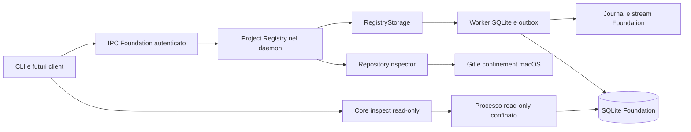

# Implementation Plan: Project Registry & Local Git Repositories

**Feature branch**: `002-project-registry` | **Date**: 2026-11-10 | **Spec**: [spec.md](spec.md)  
**Input**: `/Users/fabioaltea/Repository/maestro/specs/002-project-registry/spec.md`  
**Status**: implementazione locale in corso; T001–T047 conclusi, G1/S1/E1 comuni e MVP US1 qualificati; US2–US4 ed E2/E3/V1 seguono i task.  
**Checkout osservato**: `001-core-background-daemon-implementation`, baseline `e84e587`.
Il selettore `.specify/feature.json` individua la 002 indipendentemente dal branch.
Implementazione sul branch 002 allineato alla baseline; un commit locale per task.

## Summary

Estendere il daemon con un registro persistente: import, elenco/dettaglio, verifica,
configurazione e rimozione della sola registrazione. Riutilizzare autenticazione,
SQLite, worker e journal/outbox Foundation. Git read-only resta dietro una porta;
commit brevi coordinano progetto, risultato idempotente ed eventi. I probe Git
avvengono fuori dalle transazioni.

Sono vincolanti i chiarimenti approvati: repository senza commit/base registrabili;
main checkout e worktree esistenti deduplicano sul repository condiviso. Il primo
checkout confermato resta il riferimento. Nessuna Discovery o lavoro Git impliciti.

## Technical Context

**Language/Version**: TypeScript 6.0.3 strict, Node.js 26.13.0, ESM/NodeNext.  
**Primary Dependencies**: better-sqlite3 13.0.3, API native Node; Git Xcode 2.50.1 (Apple Git-155), risolto con xcrun e verificato. Nessun SDK/framework aggiunto.  
**Storage**: SQLite WAL/synchronous FULL esistente; schema 3 implementato, upgrade esclusivo dalla Foundation schema 2; stesso storeId, outbox e journal bounded.  
**Testing**: node:test, porte/clock sostituibili, contratti, Git/processi reali temporanei, fault injection e acceptance con rete negata.  
**Target Platform**: macOS 26.3 arm64/APFS; host ricerca 26.3.1(a). Adapter di confinamento Git qualificato prima dell'uso; nessuna promessa multipiattaforma.  
**Project Type**: estensione dello stesso servizio headless, CLI e IPC locale.  
**Performance Goals**: SC-002: 100 progetti/1.000 letture/10 client, p95 ≤500 ms e ogni lettura ≤2 s. SC-003: 30 import/verifiche fino a 10 branch/100 commit, p95 ≤5 s e ogni tentativo ≤30 s. Target 002 non misurati.  
**Constraints**: zero scritture Git/helper/rete; 4 probe concorrenti, 32 operazioni pendenti, deadline totale 30 s inclusa coda; RPC brevi; limiti Foundation invariati.  
**Scale/Scope**: 100 progetti nel carico di accettazione, 20 import concorrenti, 100 retry e almeno 30 crash. Nessun limite funzionale artificiale a 100 progetti.

## Foundation readiness e criteri di ingresso

La baseline è implementata, **non completamente accettata**. Fonti:
[release-readiness](../001-core-background-daemon/reports/release-readiness.md),
[acceptance](../001-core-background-daemon/reports/acceptance.md),
[local-access](../001-core-background-daemon/reports/local-access.md).

| Gate | Evidenza al 2026-11-09 | Condizione richiesta |
|---|---|---|
| T082 / FR-016 Foundation | Altro UID reale/seconda macchina NOT_RUN | Prove reali documentate, non sostituite da simulazioni |
| T085 Foundation | Campagna completa IP-denied: 35 PASS / 11 FAIL / 1 SKIP; FAIL / OPEN | Campagna completa senza fallimenti o casi obbligatori saltati; diagnosi/correzioni nella 001 |
| T083 idle | PASS: 600 s, RSS max 76,56 MiB inclusi worker, CPU 0,00833% di un core | Misura del solo carico Foundation, non prestazione 002 |

**Revisione approvata dall'utente — 2026-11-10**: per iniziare lo sviluppo locale
002 servono branch allineato, build/typecheck/lint e suite ordinarie locali ripetibili.
Le prove reali con altro UID/seconda macchina e la campagna completa IP-denied sono
**gate di accettazione finale/rilascio**, non prerequisiti per scrivere e testare il
registro sul Mac corrente. I risultati Foundation rimangono NOT_RUN/FAIL finché
non esistono nuove evidenze reali; nessuna soglia o requisito è eliminato.
T002 registra questa separazione, T003 verifica la baseline locale e T004 chiude P0.
T093/T096 devono verificare nuovamente i gate finali; se mancanti la readiness resta
BLOCKED. G1 Git rimane obbligatorio prima di qualsiasi probe nei flussi utente.

## Constitution Check

PASS indica conformità del design; le prove runtime sono richieste nei checkpoint.

| Principio | Prima ricerca | Dopo design: evidenza/verifica |
|---|---|---|
| I. Local-first | PASS: registro locale | PASS: stesso SQLite e offline; SC-001/008 con rete negata |
| II. Core headless | PASS: daemon/client separati | PASS: IPC, operazioni accettate indipendenti dai client; nessun autostart |
| III. Provider agnostic | PASS: provider assenti | PASS: porte neutrali; checkpoint conversazionali N/A, nessuna sessione |
| IV. Git safety | PASS: sola lettura prevista | PASS: confinement fail-closed, identità verificata, SC-006; branch/worktree dedicati, merge e cleanup N/A perché nessun lavoro Git |
| V. Recovery | PASS: intento/esito durevoli | PASS: ledger nello stesso store, atomicità, INTERRUPTED e ownership; SC-004/005 |
| VI. Approvazioni | PASS: azione/ID/revisione nel core | PASS: autenticazione, hash intento, CAS; SC-007; nessuna autorità su cleanup/pubblicazione |
| VII. Testabilità | PASS: porte sostituibili | PASS: contratti e fixture reali, crash/concorrenza; matrice quickstart |
| VIII. Osservabilità | PASS: riuso Foundation | PASS: projectId/requestId, redazione e outbox; checkpoint E1–E3 e V1 |

Nessuna eccezione costituzionale. Readiness Foundation e qualificazione OS sono gate
empirici aperti, non prove superate.

## Architecture



Il dominio non importa filesystem, processi o driver. I client inviano intenti;
il core applica policy. Il core inspect apre readonly come nella Foundation,
senza esporre SQLite ai client. Le letture native passano da un processo transitorio
confinato senza scritture/fork/rete; il writer resta nel worker esistente. Porte
isolano Git, identità filesystem e process
ownership. Nessun secondo daemon, database o scheduler generico.

Le mutazioni vengono accettate durevolmente e completate in background; una RPC
non resta impegnata fino alla conclusione Git. `projects.operation.get` recupera
l'esito. Elenco/dettaglio non fanno probe, repair, migrazione o drain eventi.

## Phase 0 — Research

[research.md](research.md): decisioni, motivazioni, alternative e fonti per identità,
confinamento, Git empty/detached/worktree, schema, retry, recovery e contratti.
Nessuna domanda di prodotto irrisolta. La fattibilità del profilo OS va provata in
G1: un esito negativo blocca l'adapter senza fallback non confinato o attenuazione
FR-017. Il piano sceglie il confinement, non assume di averlo già verificato.

## Phase 1 — Design

- [data-model.md](data-model.md): schema, invarianti e transizioni.
- [contracts/cli.md](contracts/cli.md): comandi, codici, retry e offline.
- [contracts/local-protocol.md](contracts/local-protocol.md): IPC, errori ed eventi.
- [contracts/git-inspection.md](contracts/git-inspection.md): safety e risorse.
- [contracts/storage-recovery.md](contracts/storage-recovery.md): upgrade e crash.
- [quickstart.md](quickstart.md): review, verifiche future e copertura.

## Phase 2 — Incrementi pianificati

Ordine per i futuri task; questa consegna non genera `tasks.md`.

| Incremento | Contenuto | Uscita verificabile |
|---|---|---|
| P0 | Baseline locale e isolamento test | Branch allineato, build/typecheck/lint e suite ordinarie verdi; gate esterni tracciati per accettazione finale |
| G1 | Porta Git, runner confinato, ownership | Sentinelle helper/rete/scritture mai attivate anche con config concorrente; timeout/crash senza orfani non riconciliati; altrimenti STOP |
| S1 | Schema 3/upgrade, ledger e letture readonly | Crash upgrade conserva storeId/seq/dati; readonly non migra |
| E1 | Eventi registry persistenti minimi | Stato/esito/evento atomici e redatti, nessun falso evento su errore disco |
| US1 | Import e dedup comune | Empty/detached/clone/submodule/worktree/bare-common, alias e 20 concorrenti; zero Git write |
| US2 | Query offline, verify e recovery | Identità/config preservate, reference fisso, assenza distinta da incertezza; nessun autostart |
| US3–US4 | Configurazione CAS e tombstone | Base esplicita validata; stale revision zero effetti; vecchio retry non tocca nuova registrazione |
| E2 | Replay paginato con eventi misti | Continuità storeId/seq, gap esplicito; nessuna riscrittura storico |
| E3 | Streaming e client lento | Notifica dopo commit, buffer/deadline invariati; disconnect senza cancellazione |
| V1 | Backpressure e accettazione finale | Saturazione senza perdita di conferme, SC-001…009 e regressioni Foundation |

Persistenza, replay e streaming hanno checkpoint distinti. Le mutazioni abilitate
da US1 includono già gli eventi durevoli E1. I test degli invarianti appartengono
all'incremento che li introduce.

## Project Structure

Documentazione in `/Users/fabioaltea/Repository/maestro/specs/002-project-registry/`:

```text
plan.md
research.md
data-model.md
quickstart.md
contracts/
  cli.md
  local-protocol.md
  git-inspection.md
  storage-recovery.md
checklists/requirements.md    # esistente, relativa alla specifica
```

Layout previsto nella singola applicazione esistente:

```text
src/domain/projects/             # tipi/policy senza I/O
src/core/projects/               # coordinamento registry
src/ports/registry.ts            # persistenza e query
src/ports/repository.ts          # ispezione e identità
src/platform/macos/git/          # processi e confinement
src/platform/macos/storage/      # profilo delle letture SQLite native
src/storage/                    # schema/worker/transazioni estesi
src/protocol/                   # metodi, errori e payload eventi
src/core/{daemon-main,inspect-main,control-main}.ts
src/client/local-client.ts
src/cli/                        # sottocomandi project
tests/{unit,contract,integration,acceptance}/
```

Porte, adapter e Foundation comune implementati; le storie utente seguono i task. Dominio/client non importano adapter OS
o SQLite; i composition root collegano le porte esistenti e nuove.

## Complexity Tracking

| Scelta | Motivazione | Alternativa scartata |
|---|---|---|
| Ledger registry separato, stesso worker | Lifecycle ammette solo start/stop/restart e un pending globale | Estenderne il lock serializzerebbe impropriamente tutti i progetti |
| Confinamento OS qualificato | Anche status può eseguire filtri | Soli flag/preflight non resistono alle race |
| Schema 2 → 3 | Estensione della nuova Foundation | Secondo DB perde atomicità con outbox; nessuna migrazione del vecchio Maestro |
| Revisioni config/osservazione distinte | Verify non invalida approvazioni config | Contatore unico violerebbe FR-012 |

Nessuna violazione costituzionale. Implementazione autorizzata sul branch 002;
nessuna pubblicazione o feature successiva implicita.
