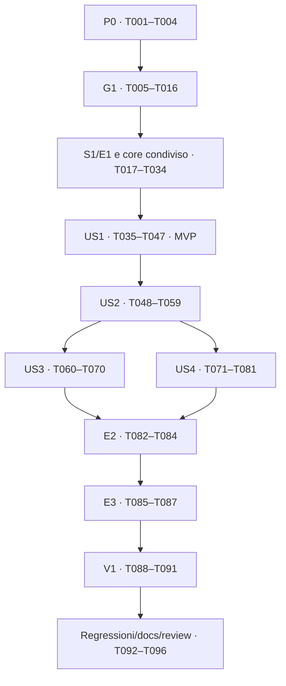

# Tasks: Project Registry & Local Git Repositories

**Feature**: `002-project-registry`  
**Created**: 2026-11-10  
**Input**: `/Users/fabioaltea/Repository/maestro/specs/002-project-registry/`  
**Prerequisites**: [spec.md](spec.md), [plan.md](plan.md), [research.md](research.md),
[data-model.md](data-model.md), [contracts/](contracts/) e [quickstart.md](quickstart.md).  
**Status**: implementazione locale in corso; T001–T012 conclusi (12/96), P0 locale
PASS. Porte e fixture disponibili; G1 ancora da qualificare. Gate esterni finali invariati.
Dettagli in [reports/entry-readiness.md](reports/entry-readiness.md).

## Format e convenzioni

- Ogni task ha checkbox, ID sequenziale, percorso concreto e dipendenze dirette.
- Gli ID appartengono alla 002: `001/T082` e `001/T085` sono prerequisiti esterni,
  distinti dagli ID omonimi di questo documento.
- `[US1]`…`[US4]` compaiono solo nelle rispettive fasi; `[P]` vale soltanto nelle wave
  esplicite, dopo tutte le dipendenze e senza modificare contemporaneamente file condivisi.
- Root assoluta dei percorsi: `/Users/fabioaltea/Repository/maestro/`. I path nei task
  sono relativi a questa root. I nuovi file e report citati sono output futuri, non
  evidenze già prodotte. Non inizializzare nuovamente package/toolchain esistenti.
- I test sono richiesti da specifica e Constitution: per comportamento nuovo scriverli
  prima del codice, osservare un RED pertinente e portarli a GREEN nel checkpoint.
  Per capacità Foundation già riusate sono valide prove nuove che passano subito;
  non introdurre codice o fallimenti artificiali per ottenere RED.
- Dopo ogni modifica eseguire le prove pertinenti e i controlli richiesti; ai checkpoint
  eseguire la slice completa. Non rinviare safety, atomicità o recovery al polish.
- Nei futuri lavori di implementazione resta la preferenza espressa di un commit locale
  per task concluso, limitato ai suoi file; questa generazione non effettua commit.
  Non segnare concluso un task che non ha raggiunto il proprio criterio di uscita.
- Fixture e archivi sono temporanei e posseduti. Eventuali creazioni di worktree,
  branch o commit nei test servono a predisporre fixture, mai al flusso applicativo.
  Nessun cleanup di dati utente, provider/Agent Runtime, Discovery, pnpm o Electron.

## Execution summary

| Area | Task | Intervallo |
|---|---:|---|
| setup | 4 | T001–T004 |
| foundation | 30 | T005–T034 |
| US1 | 13 | T035–T047 |
| US2 | 12 | T048–T059 |
| US3 | 11 | T060–T070 |
| US4 | 11 | T071–T081 |
| events | 10 | T082–T091 |
| final | 5 | T092–T096 |
| **Totale** | **96** | T001–T096 |

**MVP suggerito**: Setup + Foundational + US1, T001–T047 (47 task).
Include dettaglio minimo da secondo client, esiti offline, crash safety e eventi E1;
US2 completa lista/verifica. MVP non equivale ad accettazione completa della feature.

## Gate di ingresso e scope

| Gate | Stato alla generazione | Regola |
|---|---|---|
| Finale: 001/T082, FR-016 | NOT_RUN per altro UID reale/seconda macchina | Prova reale necessaria; mock o mancato runner non sono PASS |
| Finale: 001/T085 | FAIL / OPEN; campagna IP-denied 35 PASS / 11 FAIL / 1 SKIP | Chiusura documentata con campagna completa applicabile |
| G1: confinement Git/macOS | NOT_RUN | Zero helper/fork/rete/scritture verificati; fallimento blocca ogni probe utente |
| S1/E1/E2/E3/V1 e SC-001…009 | NOT_RUN | Verifiche future distinte; nessun target già misurato per 002 |

Fonti baseline: [release-readiness 001](../001-core-background-daemon/reports/release-readiness.md)
e [criteri di ingresso del piano](plan.md#foundation-readiness-e-criteri-di-ingresso).
**Revisione approvata dall'utente — 2026-11-10**: P0 verifica la baseline locale.
I gate 001/T082 e 001/T085 rimangono obbligatori per accettazione finale/rilascio,
ma non bloccano sviluppo e test locali 002. T093/T096 conservano il controllo dei
risultati mancanti. G1 non cambia: nessun probe utente prima del confinement qualificato.

Checkout osservato: `001-core-background-daemon-implementation`, HEAD `e84e587`;
feature selezionata in `.specify/feature.json`: 002. Allineamento futuro esplicito,
senza switch/merge/reset di branch durante questa consegna.

## Phase 1: Setup — baseline e gate P0

**Goal**: Preparare l'esecuzione sulla nuova Foundation esistente, senza un nuovo bootstrap o recupero legacy.

**Independent Test / Gate**: Baseline/branch identificati, suite locali verdi e gate finali mancanti esplicitamente tracciati, senza simulare PASS.

### Implementazione e verifica

- [X] T001 Verificare branch, HEAD, modifiche preesistenti e feature selezionata; documentare come allineare `002-project-registry` alla baseline nuova Foundation preservando ogni modifica in `specs/002-project-registry/reports/entry-readiness.md`; nessun reset, cleanup, push o commit estraneo. **Dip.: nessuna.**
- [X] T002 Registrare la revisione approvata dei gate in `specs/002-project-registry/plan.md`, `specs/002-project-registry/tasks.md` e `specs/002-project-registry/reports/entry-readiness.md`: altro UID/seconda macchina e acceptance IP-denied restano NOT_RUN/FAIL e bloccano solo accettazione finale/rilascio; nessun account, permesso o requisito safety modificato. **Dip.: T001.**
- [X] T003 Eseguire build/typecheck/lint e suite ordinarie locali definite in `package.json`, registrando comandi, esiti e campioni in `specs/002-project-registry/reports/local-baseline.md`; la campagna completa IP-denied e il runner esterno restano gate finali non dichiarati PASS. Failure locali pertinenti vanno risolte o segnalate prima di P0. **Dip.: T002.**
- [X] T004 Consolidare verdetto P0 locale, versioni Node/Git/SQLite/macOS/APFS, commit e isolamento test in `specs/002-project-registry/reports/entry-readiness.md`; PASS richiede T003 e branch allineato, non un runner esterno. Riportare i gate finali ancora mancanti senza dichiarare pronti G1 o rilascio. **Dip.: T003.**

**Esito T002 — 2026-11-10**: modifica di sequenza approvata e registrata.
La prova 001/T082 resta NOT_RUN, non è il task T002 riprogettato. Nessun PASS di
sicurezza simulato e nessuna deroga ai requisiti finali.

**Checkpoint**: P0 locale passa dopo T003/T004; gate esterni conservati per T093/T096.

## Phase 2: Foundational — G1, S1 ed E1

**Goal**: Fornire porte, confinamento qualificato, upgrade atomico, operazioni durevoli e osservabilità minima prima di qualunque user story.

**Independent Test / Gate**: Git reale confinato senza helper/rete/scritture; schema 2→3 integro dopo crash; intento/esito/eventi atomici; autorizzazione, limiti e recovery provati.

### Implementazione e verifica

- [X] T005 Definire `RepositoryInspector`, `FilesystemIdentity` e `ProbeSupervisor` in `src/ports/repository.ts`: prove versionate common-dir/admin-dir/reference checkout, capability esplicite, osservazioni nullable, deadline e cancellation; dominio senza primitive OS. **Dip.: T004.**
- [X] T006 Creare fixture locali possedute e snapshot comparativi in `tests/fixtures/project-repositories.ts` e `tests/fixtures/project-faults.ts`: unborn/detached/dirty/conflitti, cloni/annidati/submodule/main/linked/bare-common, sentinelle e checkpoint deterministici; riusare test-context e fault-schedule Foundation senza toccare repo utente. **Dip.: T005.**

### Test richiesti

- [X] T007 [P] Scrivere contratti del runner in `tests/contract/git-runner.test.ts`: binario assoluto, argv builtin, ambiente allowlisted, sandbox obbligatorio, capacità assente, stdout/config 1 MiB e stderr 16 KiB; nessun output grezzo nel risultato. Verificare il profilo del build compilato anche da un cwd esterno al repository. **Dip.: T006.**
- [X] T008 [P] Scrivere contratti di lifeline/nonce/generazione/handle posseduto in `tests/contract/project-probe-supervisor.test.ts`: EOF, deadline e stop, riuso PID, socket assente non prova di uscita e cancellazione ≤1,5 s; nessuna policy Agent Runtime. **Dip.: T006.**
- [X] T009 [P] Scrivere contratti di anchor APFS e path in `tests/contract/repository-identity.test.ts`: realpath/volume-device/inode/birthtime, alias/spazi/Unicode/newline, common-dir distinto da checkout/admin-dir, replacement e incertezza senza rebind. **Dip.: T006.**

### Implementazione e verifica

- [X] T010 [P] Implementare il runner e profilo OS in `src/platform/macos/git/runner.ts` e `src/platform/macos/git/inspection.sb`: Git verificato, shell=false, parametri separati, tutte le scritture/rete/fork negate, unico exec Git consentito, hardening previsto in `specs/002-project-registry/contracts/git-inspection.md`; capacità indisponibile blocca prima del probe. Distribuire il profilo anche nel build compilato tramite `scripts/build-assets.mjs` e `package.json`, risolvendolo rispetto al modulo e non al cwd. **Dip.: T007.**
- [X] T011 [P] Implementare `src/platform/macos/git/probe-supervisor.ts` e `src/platform/macos/git/probe-main.ts` usando il contratto ausiliari Foundation: handle diretto del solo Git figlio, lifeline, deadline autonoma, shutdown cooperativo e uscita verificata; nessun kill basato sul PID persistito o su gruppi di processi estranei. **Dip.: T008.**
- [X] T012 [P] Implementare acquisizione/confronto anchor in `src/platform/macos/git/filesystem-identity.ts` con prove versionate e limiti; canonicalizzare checkout/common-dir separatamente e non usare remote, HEAD o nome come identità. **Dip.: T009.**
- [ ] T013 Creare ed eseguire `tests/integration/git-confinement.test.ts`: hook/fsmonitor/clean-process/alias/pager/extdiff-textconv/include sentinella, Git_* ostili, config cambiata durante probe, helper che invoca Git stesso, scritture anche fuori repo e rete tentata; provare zero sentinelle/azioni remote/scritture con evidenza positiva del confinamento OS, non soltanto assenza di marker. **Dip.: T010, T011, T012.**

### Test richiesti

- [ ] T014 Scrivere i contratti di `RepositoryInspector` in `tests/contract/repository-inspector.test.ts`: HEAD BRANCH/DETACHED/UNBORN, base omessa/esplicita, bare senza checkout rifiutato, linked con common bare valido, status porcelain v2 NUL, filtri/includes unsafe→UNKNOWN e nessun falso clean. **Dip.: T013.**

### Implementazione e verifica

- [ ] T015 Implementare topologia, refs/commit e parsing status bounded in `src/platform/macos/git/repository-inspector.ts`; usare solo runner confinato, non trim sui path, nessun redirect core.worktree estraneo, niente ricorsione submodule; verificare anchor/topologia/HEAD/base prima-dopo e prima della conferma, senza snapshot atomico promesso. **Dip.: T014.**
- [ ] T016 Eseguire i contratti Git e `tests/integration/git-confinement.test.ts`, aggiungendo timeout/output enorme/config-ref-topology race e crash del processo proprietario in harness con probe attivo (il crash del daemon integrato verrà provato nelle storie) in `tests/integration/project-probe-lifecycle.test.ts`; salvare esito G1, primitiva effettiva e limiti in `specs/002-project-registry/reports/git-safety.md`. Nessuna integrazione utente se un requisito safety è FAIL/NOT_RUN. **Dip.: T015.**

### Test richiesti

- [ ] T017 [P] Scrivere test di nomi Unicode (trim, 120/121 scalar values, Cc e surrogati), normalizzazione intento senza default dinamici, revisioni distinte e transizioni terminali in `tests/unit/project-domain.test.ts`. **Dip.: T016.**
- [ ] T018 [P] Scrivere contratti storage in `tests/contract/project-storage.test.ts`: catalogo globale lifecycle/registry, hash originali immutabili, IN_PROGRESS unico pending registry, BLOCKED terminale, risultati interrogabili e conservati oltre tombstone/rotazione. **Dip.: T016.**
- [ ] T019 [P] Scrivere prove di upgrade in `tests/integration/project-schema-upgrade.test.ts`: schema 2→3 e nuovo 3, lease UID/path, FK cicliche store/instances, crash pre/post commit, FULL/IO/BUSY, schema sconosciuto e writer vivo rifiutati; storeId/seq/outbox/high-water/floor invariati. **Dip.: T016.**
- [ ] T020 [P] Scrivere codec/contratti comuni in `tests/contract/project-protocol.test.ts`: metodi projects.*, UUID/decimali/limiti/campi extra, accepted true/false, role client/controller, errori/categorie/nextAction, capability assente e envelope Foundation v1. **Dip.: T016.**

### Implementazione e verifica

- [ ] T021 Implementare tipi/validatori/policy pure in `src/domain/projects/model.ts`, `src/domain/projects/intent.ts` e porta `src/ports/registry.ts`: Project/Observation/Operation, config e observation revision separate, serializzazione canonica deterministica per hash con omissioni distinte, limiti nome/path/branch e outcome coerenti. **Dip.: T017.**
- [ ] T022 Estendere `src/storage/schema.ts` a schema 3 con projects, project_observations, project_operations, request_catalog e registry_metadata, UNIQUE parziale sui progetti attivi e tombstone; mantenere ledger/indice pending lifecycle separati e predisporre fresh create 3. Adeguare le fixture schema corrente in `tests/fixtures/test-context.ts` e i test schema Foundation interessati, mantenendo fixture schema 2 esplicite per l'upgrade. **Dip.: T021, T018, T019.**
- [ ] T023 Implementare l'upgrade transazionale esclusivo in `src/storage/registry-upgrade.ts`, collegandolo a `src/core/control-main.ts` prima del writer normale su start esplicito: detenere entrambi i lease, ricostruire store senza writable_schema, popolare catalogo con hash lifecycle invariati, verificare FK/integrità e mantenere la deadline start Foundation. **Dip.: T022.**
- [ ] T024 Implementare catalogo e admission/esiti registry in `src/storage/sqlite-store.ts` e aggiornare la prenotazione lifecycle in `src/core/operations.ts`: stessa transazione per ID/intento, confronto prima di path/revisione correnti, esito terminale immutabile, collisioni inter-scope rifiutate e nessun riuso del pending globale lifecycle. **Dip.: T023.**
- [ ] T025 Collegare il ledger e lettura readonly `projects.operation.get` in `src/storage/worker.ts` e `src/ports/storage.ts`, estendendo entrambe le allowlist readonly/failure; SQLite retry bounded, nessun await/probe in transazione, nessuna nuova connessione writer nel client. **Dip.: T024.**
- [ ] T026 Estendere i codec, allowlist metodi e safe error in `src/protocol/messages.ts`, `src/protocol/validation.ts` e `src/domain/errors.ts` secondo i contratti registry, conservando versione e limiti Foundation; non esporre metodi non ancora implementati come riusciti. **Dip.: T020, T021.**

### Test richiesti

- [ ] T027 Scrivere E1 in `tests/contract/project-events.test.ts` e `tests/integration/project-outbox.test.ts`: scope/projectId/revisioni allowlisted, operationId esplicito anche durante lifecycle concorrente, redazione sentinelle, atomico stato-esito-outbox, rollback e drain fallito/degradato; backpressure già obbligatoria per le prime mutazioni. **Dip.: T026, T025.**

### Implementazione e verifica

- [ ] T028 Integrare eventi registry in `src/protocol/events.ts` e nelle mutate di `src/storage/sqlite-store.ts`: riusare operation.*, niente nuovi store/journal, correlazione esplicita, admission/terminale atomici e degradazione postcommit; rispettare 16 KiB evento/64 KiB outbox e proteggere dati autorevoli dalla rotazione. **Dip.: T027.**

### Test richiesti

- [ ] T029 Scrivere policy con clock/storage sostituibili in `tests/unit/project-operations.test.ts`: 4 probe/32 pending, coda BUSY prima dell'accettazione, server 28 s/stop Git 26 s/client 30 s, retry stesso intento, disconnect, fence shutdown e pending crash→INTERRUPTED senza riesecuzione. **Dip.: T028.**

### Implementazione e verifica

- [ ] T030 Implementare admission e coordinatore bounded in `src/core/projects/operations.ts`: autorizzare prima di accesso agli esiti, calcolare SHA-256 nel core dalla serializzazione pura del dominio e persistere intento prima del probe, polling separato, nessun legame alla socket client, Git fuori storage worker, no nuovo scheduler generico. **Dip.: T029, T025.**
- [ ] T031 Integrare recovery/stop registry in `src/core/projects/recovery.ts`, `src/core/daemon-main.ts` e `src/core/lifecycle.ts`: riconciliare supervisor verificati e finalizzare pending INTERRUPTED prima di RUNNING; fence prima STOPPING, budget stop 10 s/drain 8 s e BLOCKED se risorse/storage incerti. **Dip.: T030, T011.**
- [ ] T032 Predisporre dispatch autenticato e `projects.operation.get` in `src/core/projects/dispatch.ts`, `src/core/daemon-main.ts`, `src/core/inspect-main.ts` e `src/core/runtime.ts`; usare stato capacità Git cached al bootstrap, nessun probe in status/query, mutazioni solo client/RUNNING e ruolo controller senza permessi registry. **Dip.: T031, T026.**
- [ ] T033 Aggiungere polling condiviso 50–250 ms, requestId stabile e query esito live/offline in `src/client/local-client.ts` e `src/ports/platform.ts`; capability/versione assente rifiutata, timeout UNKNOWN_OUTCOME senza nuovo ID o autostart. **Dip.: T032.**
- [ ] T034 Eseguire test comuni, upgrade con fault injection e controlli di autorizzazione/lifecycle in `tests/integration/project-foundation.test.ts`; consolidare S1/E1 in `specs/002-project-registry/reports/foundation.md` con run/exit/campioni e verificare che risultati/readonly funzionino anche durante failure worker. **Dip.: T033, T028, T023, T016.**

**Checkpoint**: G1, S1 ed E1 PASS; tutti i test foundation verdi. Un G1 FAIL blocca i probe utente: nessun fallback non confinato.

## Phase 3: User Story 1 — Registrare un repository locale (P1, MVP)

**Goal**: Importare un checkout locale valido senza modificarlo, con ID stabile e deduplicazione sul common repository.

**Independent Test / Gate**: Da CLI registrare repo temporaneo anche empty/detached, interrogarlo da un secondo client e reimportare alias/main/linked: stesso progetto e riferimento; snapshot Git invariato.

### Test richiesti

- [ ] T035 [P] [US1] Scrivere contratti add/show/operation e projects.register/get in `tests/contract/project-register.test.ts`: omissioni/name/base, ID stabili, safe error/exit, role controller negato, assenza daemon/capability, requestId e timeout senza nuovo intento. **Dip.: T034.**
- [ ] T036 [P] [US1] Scrivere test unitari in `tests/unit/project-register.test.ts`: default nome da root valido, base omessa valida oppure null, base esplicita invalida rifiutata anche su duplicato, dedup senza modifiche implicite, UUID generato soltanto per il vincitore. **Dip.: T034.**
- [ ] T037 [P] [US1] Scrivere integrazione Git reale in `tests/integration/project-register.test.ts`: tutti i 7 scenari US1, spazi/Unicode/alias/subdir, cloni stesso remoto distinti, repo annidati/submodule distinti, main/linked/common-bare equivalenti, bare senza checkout rifiutato e dirty/conflitti/file-status UNKNOWN preservati. **Dip.: T034.**
- [ ] T038 [P] [US1] Scrivere almeno 10 casi crash import in `tests/integration/project-register-crash.test.ts`, distribuiti admission/probe/pre-post commit/pre-ACK e drain; dopo restart e retry stesso ID provare 0 conferme perse, parziali e duplicati, nessuna ricreazione repo o auto-riesecuzione del probe. **Dip.: T034.**

### Implementazione e verifica

- [ ] T039 [US1] Implementare commit REGISTER e get minimo in `src/storage/sqlite-store.ts`, collegandoli in `src/storage/worker.ts`: UNIQUE parziale common identity, confronto prova completa, controllo sostituzione/incertezza, progetto/osservazione/esito/eventi nello stesso commit; duplicato EXISTING non aggiorna config/reference/osservazione. **Dip.: T035, T036, T037, T038.**
- [ ] T040 [US1] Implementare `src/core/projects/register.ts`: usare intento originale, probe confinato e prove coerenti precommit, accettare unborn/detached/no-base, validare branch esplicito a commit e calcolare i default una volta; niente Discovery o script. **Dip.: T039.**
- [ ] T041 [US1] Implementare dettaglio minimo confermato in `src/core/projects/read.ts` e get offline in `src/core/inspect-main.ts`: ID/config/reference/ultima osservazione e data, DTO senza anchor interni, nessun Git o writer. Permettere l'interrogazione indipendente del MVP senza attendere US2. **Dip.: T040.**
- [ ] T042 [US1] Collegare solo register/get pronti al dispatch in `src/core/projects/dispatch.ts` e `src/core/daemon-main.ts`, dichiarando capability registry v1 e capacità Git effettive senza simulare metodi futuri; richieste non autorizzate o daemon non RUNNING hanno zero effetti. **Dip.: T041.**
- [ ] T043 [US1] Collegare register/get in `src/client/local-client.ts` e implementare `project add`, `project show`, `project operation` in `src/cli/projects.ts` e `src/cli/main.ts`: path relativo→assoluto prima dell'intento, output umano/JSON, requestId visibile, nextAction ed exit deterministici, nessun autostart. **Dip.: T042.**
- [ ] T044 [US1] Aggiungere ed eseguire 100 retry identici e 20 import concorrenti via alias/main/linked in `tests/acceptance/project-register-concurrency.test.ts`; verificare un solo progetto attivo, stesso ID e zero modifiche implicite, payload diverso/collisione lifecycle rifiutati e disconnect dopo acceptance senza perdita del lavoro. **Dip.: T043.**
- [ ] T045 [US1] Eseguire `tests/integration/project-register-crash.test.ts` e i contratti/unitari/integrazione US1, registrando checkpoint/esiti in `specs/002-project-registry/reports/recovery.md`; verificare anche storage FULL/IO e ACK perso, senza falso successo/evento. **Dip.: T044.**
- [ ] T046 [US1] Eseguire il percorso indipendente da due client in `tests/acceptance/project-register.test.ts`, senza rete/provider/UI; includere invalid path/accesso negato/non Git e confronto snapshot di contenuti/index/ref/config/oggetti per tutte le fixture registrabili. **Dip.: T045.**
- [ ] T047 [US1] Consolidare risultati e limiti MVP in `specs/002-project-registry/reports/us1.md`: tutti i 7 scenari US1, ≥10 crash import, SC-004 e correlazione E1; distinguere PASS/FAIL/NOT_RUN e fermare la slice se un invariante è aperto. **Dip.: T046.**

**Checkpoint**: US1 fruibile da due client con dettaglio minimo ed esiti durevoli. Nessuna dipendenza da US2/US3/US4 per la prova MVP.

## Phase 4: User Story 2 — Ritrovare e verificare i progetti (P1)

**Goal**: Consultare il registro storico e aggiornare esplicitamente le osservazioni senza modificare configurazione o reference checkout.

**Independent Test / Gate**: Dopo restart/disconnessione elenco e dettaglio conservano ID/config; a daemon fermo si leggono senza scritture; verify su repo/worktree assente o cambiato conserva il progetto e segnala l'incertezza.

### Test richiesti

- [ ] T048 [P] [US2] Scrivere contratti list/detail/operation offline e verify in `tests/contract/project-read-verify.test.ts`: freshness del registro distinta da osservazione, pagine ≤60 KiB/100 record, cursor store/revision-bound, REGISTRY_CHANGED e assenza/schema2/corruzione/accesso negato espliciti. **Dip.: T047.**
- [ ] T049 [P] [US2] Scrivere policy di osservazione in `tests/unit/project-observation.test.ts`: boolean nullable, base UNCONFIGURED/VALID/INVALID/UNVERIFIED, reference-only/submodule limitation, configRevision invariata, CAS config+observation revision e verify superato non pubblicato. **Dip.: T047.**
- [ ] T050 [P] [US2] Scrivere i 6 scenari US2 in `tests/integration/project-read-verify.test.ts`: readonly offline senza directory/sidecar/Git/autostart, restart, checkout spostato/negato, repository sostituito e linked reference eliminato con common ancora vivo; niente fallback o rebind. **Dip.: T047.**
- [ ] T051 [P] [US2] Scrivere fault injection verify in `tests/integration/project-verify-lifecycle.test.ts`: disconnessione, stop durante coda/probe, crash→INTERRUPTED, worker failure e outbox bloccata; tempi controllo/letture non occupati da RPC Git e nessun evento di verifica falsa. **Dip.: T047.**

### Implementazione e verifica

- [ ] T052 [US2] Implementare lista paginata e publish observation CAS in `src/storage/sqlite-store.ts` e `src/storage/worker.ts`, estendendo entrambe le allowlist readonly/failure: registryRevision aggiornata solo su visibilità, nessuna transazione tra pagine, reject OBSERVATION_SUPERSEDED senza sovrascrivere dati nuovi. **Dip.: T048, T049, T050, T051.**
- [ ] T053 [US2] Completare `src/core/projects/read.ts` e `src/core/inspect-main.ts` per list/get/operation: osservazioni datate, reference esplicito, stato base proiettato sulla config corrente, LAST_KNOWN offline, schema2 non migrato e nessun probe/drain/repair nascosto. **Dip.: T052.**
- [ ] T054 [US2] Implementare `src/core/projects/verify.ts`: catturare context revision, ispezionare solo il reference, conservare config/identity su assenza/incertezza e pubblicare osservazione con safe error; base null resta null dopo primo commit esterno, verify non certifica readiness. **Dip.: T053.**
- [ ] T055 [US2] Collegare list/verify e dettaglio completo in `src/core/projects/dispatch.ts`, `src/client/local-client.ts` e `src/cli/projects.ts`: `project list` paginato e `project verify` con polling, exit 0 solo per osservazione salvata distinguendo availability/error, no autostart. **Dip.: T054.**
- [ ] T056 [US2] Aggiungere ed eseguire verify concorrenti, ref/topology mutate tra probe/commit, primo commit esterno e base eliminata in `tests/integration/project-observation-races.test.ts`; controllare che config revision sia preservata e le evidenze obsolete non vincano. **Dip.: T055.**
- [ ] T057 [US2] Eseguire `tests/integration/project-verify-lifecycle.test.ts` e le prove recovery/read-only del capitolo US2, registrando esiti in `specs/002-project-registry/reports/recovery.md`; provare stop entro budget Foundation e nessun orfano dichiarato assente su sola evidenza PID/socket. **Dip.: T056.**
- [ ] T058 [US2] Creare ed eseguire `tests/acceptance/project-read-verify.test.ts` con due client, restart e daemon fermo; confrontare 100% ID/config confermati, data/natura storica delle osservazioni e nessuna scrittura/ricreazione repo o state-dir dalle query. **Dip.: T057.**
- [ ] T059 [US2] Consolidare tutti i 6 scenari US2, osservazioni parziali/non verificabili e prove richieste in `specs/002-project-registry/reports/us2.md`; riferire SC-008 e distinguere successo della persistenza da verifica positiva Git. **Dip.: T058.**

**Checkpoint**: US2 completa e indipendente da configurazione/rimozione P2; la prima commit esterna non configura automaticamente la base.

## Phase 5: User Story 3 — Configurare nome e branch di base (P2)

**Goal**: Modificare soltanto la configurazione Maestro con approvazione legata alla revisione corrente.

**Independent Test / Gate**: Due client aggiornano la stessa revisione: uno solo confermato; HEAD/index/file non cambiano. Rename/clear-base funzionano su repo non disponibile; set-base richiede ref locale valida.

### Test richiesti

- [ ] T060 [P] [US3] Scrivere contratti projects.update e CLI update in `tests/contract/project-update.test.ts`: expectedRevision obbligatoria, patch non vuota, omissione/null/stringa distinti, flag clear/base esclusivi, stesso requestId interrogabile e safe error senza autorità aggiuntiva. **Dip.: T059.**
- [ ] T061 [P] [US3] Scrivere unitari CAS/no-op/nome/base in `tests/unit/project-update.test.ts`: revisione obsoleta zero effetti, nome-only indipendente da Git, base esplicita validata a commit, patch atomica e osservazione precedente dichiarata storica sulla config nuova. **Dip.: T059.**
- [ ] T062 [P] [US3] Scrivere integrazione dei 6 scenari US3 in `tests/integration/project-update.test.ts`: branch locale valido/detached, remote/inesistente/unborn rifiutati, base cancellata esternamente conservata INVALID, primo commit esterno conserva ID/base null e Git invariato. **Dip.: T059.**
- [ ] T063 [P] [US3] Scrivere almeno 10 casi crash update in `tests/integration/project-update-crash.test.ts` prima/durante/dopo commit e prima ACK; retry deve restituire configurazione/esito originali completi, mai patch parziale o successo senza persistenza. **Dip.: T059.**

### Implementazione e verifica

- [ ] T064 [US3] Implementare commit UPDATE CAS in `src/storage/sqlite-store.ts`, collegandolo al worker in `src/storage/worker.ts`: expected configRevision e progetto attivo verificati, incremento solo su cambi effettivi, registryRevision coerente e atomicità config/esito/evento; mantenere identità/reference immutabili. **Dip.: T060, T061, T062, T063.**
- [ ] T065 [US3] Implementare `src/core/projects/update.ts`: rinomina/clear-base senza probe, set-base con Git confinato e identità/ref coerenti ricontrollate prima della conferma; invalidare evidenze della vecchia base senza cancellare lo storico o inventare osservazioni. **Dip.: T064.**
- [ ] T066 [US3] Collegare projects.update e `project update --expected-revision` in `src/core/projects/dispatch.ts`, `src/client/local-client.ts` e `src/cli/projects.ts`; autorizzazione/rilettura revisioni nel core, intento immutabile per retry, nessun checkout o prompt aggiuntivo. **Dip.: T065.**
- [ ] T067 [US3] Creare ed eseguire `tests/integration/project-update-verify-races.test.ts`: due update stessa revisione, verify completato dopo update, verify che non invalida rename, base cambiata durante probe e update da client non autorizzato; uno solo vince ove richiesto, zero sovrascritture silenziose. **Dip.: T066.**
- [ ] T068 [US3] Eseguire `tests/integration/project-update-crash.test.ts`, unitari/contratti e integrazione US3; appendere ≥10 campioni con config/revisioni/esiti/eventi a `specs/002-project-registry/reports/recovery.md` includendo timeout e failure. **Dip.: T067.**
- [ ] T069 [US3] Creare ed eseguire `tests/acceptance/project-update.test.ts`: flusso CLI da due client, restart/retry, repo non accessibile per rename/clear e snapshot HEAD/index/ref/config/contenuti invariati; nessuna dipendenza da US4 per il gate. **Dip.: T068.**
- [ ] T070 [US3] Consolidare copertura dei 6 scenari US3, CAS, Git safety e ≥10 crash update in `specs/002-project-registry/reports/us3.md`, senza presentare base valida come approvazione di future operazioni. **Dip.: T069.**

**Checkpoint**: Tutti i 6 scenari US3 verdi, ≥10 crash update; una verifica non cambia configRevision e non configura una base prima assente.

## Phase 6: User Story 4 — Rimuovere soltanto la registrazione (P2)

**Goal**: Rendere inattivo il progetto identificato preservando integralmente repository e lavoro locale.

**Independent Test / Gate**: Remove di progetto dirty con ID/revisione corretti, retry identico e nuova registrazione: file invariati, nuovo projectId e vecchio retry senza effetti sul nuovo progetto.

### Test richiesti

- [ ] T071 [P] [US4] Scrivere contratti projects.remove/CLI remove in `tests/contract/project-remove.test.ts`: ID/revisione richiesti, autorizzazione e intenti diversi rifiutati, query tombstone e outcome storico dopo reimport, nessun flag force/cleanup. **Dip.: T059.**
- [ ] T072 [P] [US4] Scrivere policy ACTIVE→REMOVED e retry in `tests/unit/project-remove.test.ts`: stale revision/ID errato zero effetti, stessa rimozione restituisce risultato originale, Git indisponibile non impedisce la sola rimozione del registro. **Dip.: T059.**
- [ ] T073 [P] [US4] Scrivere i 4 scenari US4 in `tests/integration/project-remove.test.ts`: dirty/untracked/conflitti preservati, main/linked e altri progetti intatti, tombstone conserva ledger, reimport nuovo UUID e vecchio retry non rimuove il nuovo progetto. **Dip.: T059.**
- [ ] T074 [P] [US4] Scrivere almeno 10 casi crash remove in `tests/integration/project-remove-crash.test.ts`: pre/post commit/ACK e journal drain, stato ACTIVE oppure tombstone completa con esito/evento, zero cancellazioni Git e retry sicuro. **Dip.: T059.**

### Implementazione e verifica

- [ ] T075 [US4] Implementare commit REMOVE CAS e tombstone in `src/storage/sqlite-store.ts` e `src/storage/worker.ts`: configRevision e registryRevision incrementate, esclusione da lista attiva, risultati idempotenti conservati, nessuna cancellazione di file o altri progetti. **Dip.: T071, T072, T073, T074.**
- [ ] T076 [US4] Implementare `src/core/projects/remove.ts`: autorizzare solo projectId/expectedRevision, non richiedere repo disponibile o probe, impedire a verifiche in volo di ripubblicare progetto/osservazioni dopo la tombstone. **Dip.: T075.**
- [ ] T077 [US4] Collegare projects.remove e `project remove --expected-revision` in `src/core/projects/dispatch.ts`, `src/client/local-client.ts` e `src/cli/projects.ts`; distinguere progetto sconosciuto/rimosso, restituire esito originale prima dei controlli sullo stato corrente nei retry. **Dip.: T076.**
- [ ] T078 [US4] Creare ed eseguire `tests/integration/project-remove-verify-races.test.ts`: remove durante verify, due rimozioni stessa revisione, nuova registrazione durante vecchio retry, intento non autorizzato; nessuna resurrezione o cancellazione del nuovo UUID. **Dip.: T077.**
- [ ] T079 [US4] Eseguire `tests/integration/project-remove-crash.test.ts` e le suite US4; appendere ≥10 campioni in `specs/002-project-registry/reports/recovery.md` e controllare insieme ai campioni import/update il totale SC-005 ≥30. **Dip.: T078.**
- [ ] T080 [US4] Creare ed eseguire `tests/acceptance/project-remove.test.ts` da CLI con repo dirty/assente e secondo client; confrontare snapshot integrali, osservare eventi correlati e interrogare l'esito anche offline dopo stop/restart. **Dip.: T079.**
- [ ] T081 [US4] Consolidare i 4 scenari US4 e la prova nuovo UUID/vecchio retry in `specs/002-project-registry/reports/us4.md`; confermare che rimozione registro non significa cancellazione, cleanup worktree o ripristino automatico della registrazione. **Dip.: T080.**

**Checkpoint**: Tutti i 4 scenari US4 verdi, ≥10 crash remove; nessun comando di cleanup o rebind e nessuna perdita di dati idempotenti.

## Phase 7: Eventi condivisi — E2, E3 e V1

**Goal**: Qualificare separatamente replay, streaming e backpressure per tutte le storie, riusando l'infrastruttura Foundation già attiva.

**Independent Test / Gate**: Storico misto ordinato/correlato con gap esplicito; stream lento disconnesso senza perdere stato; limiti e tempi rispettati sotto carico Git.

### Test richiesti

- [ ] T082 Scrivere E2 in `tests/contract/project-event-replay.test.ts`: storico Foundation+registry, cursor store-bound, operationId/projectId/revisioni e redazione, pagina ≤60 KiB, gap esplicito; nessuna nuova tassonomia eventi o riscrittura del journal. **Dip.: T070, T081.**

### Implementazione e verifica

- [ ] T083 Creare ed eseguire `tests/integration/project-event-replay.test.ts` su journal/outbox reali: replay prima/dopo restart e drain failure, seq continui/univoci, retention floor/gap e tutte le mutazioni registry; qualificare il riuso di event-pump/journal esistenti senza introdurre duplicati. **Dip.: T082.**
- [ ] T084 Eseguire il checkpoint E2 e consolidare prove/comandi in `specs/002-project-registry/reports/events.md`; dimostrare che un client aggiornato legge anche eventi Foundation precedenti, senza promettere compatibilità dei vecchi binari con schema/nuovi metodi. **Dip.: T083.**

### Test richiesti

- [ ] T085 [P] Scrivere E3 in `tests/contract/project-event-stream.test.ts`: payload registry mantenuti dal client, cursor avanzato solo dopo callback riuscita, callback fallita/frame rifiutato non consumano il cursor, nessuna riconnessione/retry di intenti nascosta. **Dip.: T084.**
- [ ] T086 [P] Scrivere E3 in `tests/integration/project-event-stream.test.ts`: replay→live senza buchi, frame solo dopo commit, eventi di tutte le azioni, 10 client/client lento, disconnect e stop/restart; buffer ≤1 MiB/client e deadline Foundation immutate. **Dip.: T084.**

### Implementazione e verifica

- [ ] T087 Eseguire i test E3 e adeguare soltanto i codec/cursor necessari ai contratti di `src/core/live-events.ts`, `src/protocol/event-pump.ts` e `src/client/local-client.ts` già riusati; appendere prove in `specs/002-project-registry/reports/events.md` e bloccare il checkpoint se il nuovo payload/cursor non è preservato. **Dip.: T085, T086.**

### Test richiesti

- [ ] T088 [P] Scrivere V1 in `tests/integration/project-backpressure.test.ts`: 4 probe/32 pending, 33esima richiesta BUSY accepted=false, stdout/config/stderr bounded, outbox/journal/WAL saturi, drain FULL/IO e client lento; dati autorevoli/esiti non ruotati e nessun falso commit/evento. **Dip.: T087.**
- [ ] T089 [P] Creare carichi ripetibili in `tests/acceptance/project-performance.test.ts`: SC-002 (100 progetti, 1.000 letture, 10 client) e SC-003 (30 import/verify fino a 10 branch/100 commit), includendo repo lento/inaccessibile e tempi status/stop; campioni end-to-end comprensivi di pagine/coda/polling, errori e timeout. **Dip.: T087.**

### Implementazione e verifica

- [ ] T090 Completare osservabilità delle attese e degli esaurimenti in `src/core/diagnostics.ts` e `src/core/projects/operations.ts`: conteggi bounded di pending/probe, categorie BUSY/backpressure/persistenza, letture disponibili e nessun path/output/secret nei log; applicare le stesse ammissioni anche agli errori e verify senza aggirare outbox. **Dip.: T088.**
- [ ] T091 Eseguire `tests/integration/project-backpressure.test.ts` e `tests/acceptance/project-performance.test.ts`, poi idle reale con `tests/acceptance/idle-resources.test.ts` e `tests/acceptance/benchmark-foundation.ts` separatamente; salvare campioni/p95/max/error rate e memoria/CPU attiva vs idle in `specs/002-project-registry/reports/performance.md`. Target: p95 letture ≤500 ms/tutte ≤2 s, probe p95 ≤5 s/tutti ≤30 s, idle 150 MiB/1% per 600 s e budget diagnostici invariati. **Dip.: T090, T089.**

**Checkpoint**: E2, E3 e V1 hanno evidenze distinte; nessuna implementazione monolitica del sistema eventi e nessun limite Foundation aumentato.

## Phase 8: Polish e verifica trasversale

**Goal**: Consolidare evidenze reali, regressioni e documentazione dei soli comportamenti implementati.

**Independent Test / Gate**: Suite esistenti e registry verificabili senza provider/UI/rete; tutti i requisiti e scenari hanno evidenza esplicita, nessuna soglia promossa a misura senza prova.

### Implementazione e verifica

- [ ] T092 Estendere/eseguire i controlli esistenti in `tests/contract/architecture.test.ts` e `scripts/check-architecture.mjs` sui nuovi percorsi: dominio/client senza OS/SQLite/processi, stessa infrastruttura daemon/storage/eventi e nessun provider/Discovery/runtime/worktree management/pnpm/Electron; registrare risultato in `specs/002-project-registry/reports/acceptance.md`. **Dip.: T091.**
- [ ] T093 Eseguire build/typecheck/lint, `npm test`, test:contract/integration e acceptance completa da `package.json` con rete IP negata, archivi temporanei e runner reale con altro UID/seconda macchina per 001/T082; se indisponibile mantenere il task di accettazione finale aperto e la readiness BLOCKED; verificare anche la chiusura reale di 001/T085 e consolidare regressioni Foundation e registry in `specs/002-project-registry/reports/acceptance.md`, mantenendo fallimenti/skip/timeout visibili e benchmark separati dal carico concorrente. **Dip.: T092.**
- [ ] T094 Aggiornare `README.md`, `specs/002-project-registry/quickstart.md` e `AGENTS.md` con comandi realmente disponibili, errori/exit/retry, upgrade, piattaforma/profilo qualificato, scope reference/submodule e target vs misure; preservare byte per byte il blocco manuale AGENTS e non dichiarare accettati gate aperti. **Dip.: T093.**
- [ ] T095 Verificare la copertura di FR-001…020, NFR-001…005, SC-001…009, tutti i 23 scenari delle quattro storie e gli edge case in `specs/002-project-registry/reports/acceptance.md`; controllare ≥10 crash per import/update/remove, 100 retry/20 import concorrenti, 100% configurazioni confermate preservate e 0 segreti/effetti non autorizzati. **Dip.: T094.**
- [ ] T096 Revisionare diff, evidenze G1/S1/E1/E2/E3/V1 e stato Foundation in `specs/002-project-registry/reports/release-readiness.md`; dichiarare release ready solo con tutti i gate richiesti PASS, altrimenti BLOCKED con cause/nextAction. Una review completata non chiude automaticamente task runtime falliti o autorizza pubblicazione/fasi successive. **Dip.: T095.**

**Checkpoint**: Review conclusa con PASS oppure BLOCKED motivato; FAIL/NOT_RUN obbligatori impediscono la dichiarazione di completezza. Nessun push, cleanup o nuova feature impliciti.

## Dependencies & Execution Order



Le dipendenze dirette di ciascun task sono normative. Le fasi seguono l'ordine di priorità;
US1 precede US2 perché crea il contesto utente, ma le prove US2 possono predisporlo
con fixture isolate. US3 e US4 dipendono dalle primitive e letture/verifiche P1,
non l'una dall'altra: possono avere test preparati in parallelo. I loro commit a
`src/storage/sqlite-store.ts`, `src/core/projects/dispatch.ts`,
`src/client/local-client.ts`, `src/cli/projects.ts` e al report recovery vanno serializzati.
Una dipendenza funzionale fra US3 e US4 non va inventata per mascherare conflitti di file.

Prima di ogni task controllare predecessori e gate; le label `[P]` non autorizzano
ad avviare automaticamente agenti. Le esecuzioni reali acceptance/benchmark/idle
sono seriali e separate dai carichi per non contaminare tempi e consumo.
E1 precede tutte le storie; E2/E3 qualificano il riuso dopo che tutte le azioni
esistono. Backpressure è già obbligatoria in E1 e admission: V1 la riprova sotto carico.

## Opportunità ed esempi di esecuzione parallela

| Wave | Precondizione | Task su file distinti |
|---|---|---|
| Contratti G1 | T006 | T007, T008, T009 |
| Adapter G1 | rispettivi contratti RED | T010, T011, T012 |
| Contratti S1 e dominio | T016 | T017, T018, T019, T020 |
| US1 | T034 | T035, T036, T037, T038 |
| US2 | T047 | T048, T049, T050, T051 |
| US3 | T059 | T060, T061, T062, T063 |
| US4 | T059 | T071, T072, T073, T074 |
| E3 | T084 | T085, T086 |
| V1, sola preparazione | T087 | T088, T089 |

Questi sono esempi concreti di scrittura su file distinti, non comandi da eseguire
in questa fase. Per ciascuna storia:

```text
US1 dopo T034: T035 tests/contract/project-register.test.ts || T036 tests/unit/project-register.test.ts
US2 dopo T047: T048 tests/contract/project-read-verify.test.ts || T049 tests/unit/project-observation.test.ts
US3 dopo T059: T060 tests/contract/project-update.test.ts || T061 tests/unit/project-update.test.ts
US4 dopo T059: T071 tests/contract/project-remove.test.ts || T072 tests/unit/project-remove.test.ts
```

## Copertura requisiti e scenari

| Requisito 002 | Task principali |
|---|---|
| FR-001 | T043, T055, T066, T077 |
| FR-002 | T014, T015, T037, T046 |
| FR-003 | T009, T012, T039, T044 |
| FR-004 | T036, T039, T044 |
| FR-005 | T017, T021, T036, T061 |
| FR-006 | T014, T036, T040, T062 |
| FR-007 | T062, T065, T069 |
| FR-008 | T015, T041, T049, T053, T054 |
| FR-009 | T048, T050, T053, T058 |
| FR-010 | T050, T054, T056 |
| FR-011 | T013, T012, T015, T050, T056 |
| FR-012 | T049, T052, T067, T078 |
| FR-013 | T018, T024, T033, T044, T073 |
| FR-014 | T019, T028, T045, T068, T079 |
| FR-015 | T029, T030, T044, T057 |
| FR-016 | T072, T075, T073, T080 |
| FR-017 | T007, T010, T013, T016 |
| FR-018 | T020, T026, T032, T035, T060, T071 |
| FR-019 | T027, T028, T084, T087, T091 |
| FR-020 | T040, T046, T092 |
| NFR-001 | T046, T058, T093 |
| NFR-002 | T049, T053, T054, T059 |
| NFR-003 | T007, T029, T030, T089, T091 |
| NFR-004 | T007, T027, T028, T090, T093 |
| NFR-005 | T013, T016, T046, T080, T088 |
| SC-001 | T047, T059, T070, T081, T095 |
| SC-002 | T048, T089, T091 |
| SC-003 | T089, T091 |
| SC-004 | T044, T047 |
| SC-005 | T045, T068, T079, T095 |
| SC-006 | T013, T016, T037, T069, T080 |
| SC-007 | T020, T044, T067, T078 |
| SC-008 | T050, T057, T058 |
| SC-009 | T027, T028, T084, T087, T093 |

| Scenari / contratto | Copertura indipendente |
|---|---|
| US1: scenari 1–7 | T037, T038, T044, T046, T047 |
| US2: scenari 1–6 | T050, T051, T056, T058, T059 |
| US3: scenari 1–6 | T062, T067, T068, T069, T070 |
| US4: scenari 1–4 | T073, T078, T079, T080, T081 |
| Git inspection | T007, T008, T009, T014, T016 |
| Storage/recovery | T018, T019, T028, T029, T034 e crash nelle singole storie |
| CLI/API locale | T020, T035, T048, T060, T071 |
| Eventi: persistenti/replay/live/backpressure | T027, T082, T085, T086, T088 |

Copertura Constitution: I/II in query offline, disconnessione e rete negata; III in
contratti senza provider e controlli architetturali; IV in G1 e snapshot Git per storia;
V in upgrade/ledger/crash/recovery; VI in auth/CAS/hash intento nel core; VII in porte,
clock, contratti e Git reale; VIII in E1/E2/E3/V1 e sentinelle di redazione. Merge,
cleanup Git, sessioni agente e approvazione Discovery sono N/A per lo scope, senza
introdurre infrastruttura futura. Gli edge case dello spec sono distribuiti tra
G1, test di import/verify, CAS, fault injection e rimozione; l'audit finale li ricontrolla.

## Implementation strategy

1. Chiudere P0 e qualificare G1, senza aggirare i gate per iniziare il codice utente.
2. Completare S1/E1/core comune e verificare l'atomicità prima della prima registrazione.
3. Consegnare US1 come MVP interrogabile e crash safe; fermarsi al checkpoint per review.
4. Aggiungere US2, quindi US3 e US4 con test/criteri autonomi; integrare in sequenza i file comuni.
5. Qualificare E2, E3 e V1 separatamente; eseguire tutte le regressioni, aggiornare docs
   e produrre review con esito esplicito. Nessuna pubblicazione o feature successiva automatica.

I report devono conservare comandi, commit/versioni/OS, campioni falliti/timeout e
NOT_RUN. Percentili nearest-rank, end-to-end e denominatore completo; non usare
retry o warm-up invisibili. Misure Foundation precedenti non certificano i carichi
registry. I risultati idempotenti sono dati autorevoli, non log ruotabili.

## Validazione della lista

96 task generati; T001–T012 conclusi, T013–T096 ancora aperti. ID T001–T096 univoci e consecutivi; 30 label `[P]` nelle wave
sopra; ogni task ha path e dipendenze precedenti, senza cicli. Label storia soltanto
nelle quattro fasi US. Matrice completa: 20 FR, 5 NFR, 9 SC e 23 scenari.
Questa è validazione documentale, non prova runtime o PASS dei gate aperti.
